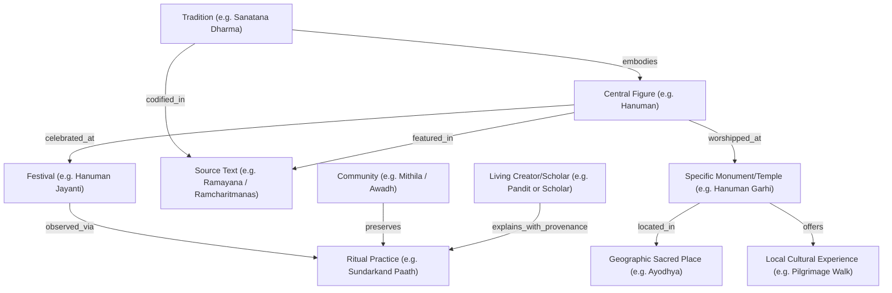

# EKA — Knowledge Graph Architecture (v1.0)

**Document ID:** KNOW-004 / 07_KNOWLEDGE_GRAPH.md  
**Status:** APPROVED  
**Classification:** Core Data Architecture  
**Prerequisite For:** Database Schema, Graph Querying, AI Retrieval

---

## 1. Executive Summary

The **EKA Knowledge Graph** is the semantic connective tissue linking humanity's sacred traditions, geographical loci, communities, rituals, literature, and living creators.

While traditional social networks connect users via superficial follow/friend graphs, and search engines index unstructured keywords, EKA links entities with rich, bidirectional, and verified semantic relationships.

---

## 2. Core Entity Types

The graph models 22 standardized entity classes:

| Class             | Description                                            | Example                                      |
| :---------------- | :----------------------------------------------------- | :------------------------------------------- |
| `Tradition`       | Broad spiritual or philosophical lineage               | Advaita Vedanta, Theravada, Sufism           |
| `Community`       | Social, ethnic, or regional group preserving tradition | Newar community, Iyengars, Baul singers      |
| `Culture`         | Civilizational or regional lifestyle context           | Bengali culture, Kyoto Zen culture           |
| `Place`           | Geographic city, valley, sacred river, or region       | Varanasi, Bodh Gaya, Mount Kailash           |
| `Monument/Temple` | Physical architectural site or shrine                  | Brihadeeswara Temple, Rumtek Monastery       |
| `Practice`        | Contemplative, devotional, or physical action          | Vipassana meditation, Sandhyavandanam        |
| `Ritual`          | Structured ceremonial celebration                      | Aarti, Chhath Puja, Tea Ceremony             |
| `Festival`        | Calendar-linked cultural observance                    | Diwali, Vesak, Eid-ul-Fitr, Paryushana       |
| `Text`            | Primary canonical or literary work                     | Bhagavad Gita, Dhammapada, Guru Granth Sahib |
| `Source`          | Verifiable historical publication or inscription       | Epigraphia Indica, Oxford Early Texts        |
| `Creator`         | Authentic teacher, scholar, or practitioner            | Resident scholar, temple architect, yogi     |
| `Experience`      | Curated workshop, walking route, or retreat            | 3-day Silent Meditation, Ghat Dawn Walk      |

---

## 3. Semantic Edge Relations

Edges in the graph carry directional semantic predicates and confidence attributes:

- `associated_with`: Entity $\leftrightarrow$ Entity
- `codified_in`: Practice/Philosophy $\longrightarrow$ Canonical Text
- `celebrated_at`: Festival $\longrightarrow$ Sacred Place / Calendar Date
- `observed_by`: Practice $\longrightarrow$ Community
- `located_at`: Monument/Temple $\longrightarrow$ Geographic Coordinates
- `explained_by`: Topic $\longrightarrow$ Creator
- `supported_by`: Claim $\longrightarrow$ Primary Source Reference
- `disputed_by`: Interpretation $\longrightarrow$ Competing Hermeneutic School

---

## 4. Why the Graph is an Unassailable Moat

1. **AI Grounding Infrastructure:** General LLMs hallucinate cultural context. When an AI agent connects to EKA's graph, it can verify whether a regional ritual is canonical or folk custom, preventing offensive blunders.
2. **Compound Data Advantage:** Every reflection, practitioner verification, and community review enriches existing nodes rather than decaying in a chronological feed.
3. **From Knowledge to Commerce:** The graph enables seamless discovery from understanding a festival $\rightarrow$ visiting the sacred place $\rightarrow$ booking authentic guidance with a verified creator.
