> Canonical EKA documentation. Source of truth for product, architecture, trust and delivery decisions.
> Version: 1.0
> Document Owner: Core Architecture Team / Founder
> Status: APPROVED

# EKA Blueprint 29 — The Cultural Context Protocol (CCP)

## 1. Executive Summary & Protocol Motivation

Modern Artificial Intelligence models suffer from **cultural flattening**: when queried about spiritual practices, ancient philosophies, or sacred rituals, LLMs collapse nuanced, lineage-specific traditions into homogenized, Westernized, or generic approximations.

The **Cultural Context Protocol (CCP)** is an open, machine-readable epistemic standard designed by EKA. It provides a standardized data exchange format for representing cultural, spiritual, and philosophical knowledge with rigorous provenance, multi-vocal perspectives, and epistemic boundaries.

Just as TCP/IP standardized packet routing and HTTP standardized hypertext, the **Cultural Context Protocol** standardizes how AI systems and global digital networks query, ingest, and represent human civilizational knowledge.

---

## 2. The 11-Dimensional Context Vector

Every atomic knowledge unit in EKA is formalized as an **EKA Context Object (ECO)** comprising 11 distinct dimensions:

```mermaid
flowchart TD
    ECO["EKA Context Object (ECO)"]
    ECO --> D1["1. Entity (Canonical ID & Aliases)"]
    ECO --> D2["2. Location (Sacred Geography & Coordinates)"]
    ECO --> D3["3. Community (Lineage, Parampara, Sangha)"]
    ECO --> D4["4. Source (Primary Manuscripts, Oral Lore)"]
    ECO --> D5["5. Time (Muhurta, Tithi, Historical Era)"]
    ECO --> D6["6. Language (Etymology, Transliteration, Script)"]
    ECO --> D7["7. Tradition (Sampradaya, Darshana, Stream)"]
    ECO --> D8["8. Perspective (Polyphonic Commentaries)"]
    ECO --> D9["9. Evidence (Epigraphic, Archival, Ethnographic)"]
    ECO --> D10["10. Confidence (Explainable Trust Score 0-1)"]
    ECO --> D11["11. Relationships (Typed Semantic Graph Edges)"]
```



### The Dimensions Explained:

1. **Entity:** The canonical global URI (e.g. `eka:concept:pranayama`, `eka:ritual:sandhyavandanam`, `eka:deity:shiva`).
2. **Location:** Spatial bounding, sacred geography (Tirtha), physical temple/monastery nodes, GPS polygons.
3. **Community:** The living tradition keepers, lineages (parampara), priestly guilds, or monastic orders preserving the knowledge.
4. **Source:** Unambiguous citation to primary physical or digital folios (e.g., _Taittiriya Upanishad 1.1.1_, Rigveda, Tipitaka).
5. **Time:** Temporal rhythms, cosmic calendars (Panchangam, Lunar Tithi), seasonal festivals, and historical dating.
6. **Language:** Native phonetics (IAST transliteration, Devanagari, Pali, Tibetan), etymological roots, and vernacular variants.
7. **Tradition:** Philosophical lineage (e.g., Advaita Vedanta, Theravada Buddhism, Kashmir Shaivism, Sufi Chishti).
8. **Perspective:** Polyphonic nuance. A single entity may have divergent commentaries (e.g., Shankara vs. Ramanuja vs. Madhva).
9. **Evidence:** Provenance artefacts including scanned manuscripts, peer-reviewed monographs, epigraphic inscriptions, or verified living practice video documentation.
10. **Confidence:** Explainable trust score (0.00 to 1.00) mapped to EKA Verification Levels (L0 unverified to L5 canonical consensus).
11. **Relationships:** Typed directed RDF-style graph edges (`practicedWith`, `prescribedIn`, `counterarguedBy`, `originatesFrom`).

---

## 3. Formal Machine-Readable Specification (JSON-LD)

```json
{
  "@context": [
    "https://schema.org",
    {
      "eka": "https://eka.earth/protocol/v1#",
      "entityId": "@id",
      "epistemicTier": "eka:epistemicTier",
      "provenance": "eka:provenance",
      "temporalContext": "eka:temporalContext",
      "lineage": "eka:lineage",
      "perspectives": "eka:perspectives"
    }
  ],
  "@type": "eka:ContextObject",
  "entityId": "eka:practice:trataka",
  "name": {
    "iast": "Trāṭaka",
    "devanagari": "त्राटक",
    "english": "Fixed Gaze Meditation"
  },
  "tradition": {
    "stream": "Hatha Yoga",
    "philosophicalRoot": "eka:darshana:yoga",
    "lineageAuthority": "Natha Sampradaya"
  },
  "epistemicTier": "DOCUMENTED_TRADITION",
  "verificationLevel": 4,
  "confidenceScore": 0.96,
  "sources": [
    {
      "title": "Hatha Yoga Pradipika",
      "chapter": 2,
      "verse": 31,
      "translator": "Swami Muktibodhananda",
      "publisher": "Bihar School of Yoga",
      "citation": "HYP II.31: 'Looking intently with an unwavering gaze at a small point until tears are shed...'",
      "manuscriptRef": "MS-BODL-HYP-1422"
    }
  ],
  "perspectives": [
    {
      "commentaryBy": "Svatmarama",
      "view": "Classified strictly as one of the Shatkarmas (purification rituals) before pranayama.",
      "epistemicTier": "DOCUMENTED_TRADITION"
    },
    {
      "commentaryBy": "Contemporary Contemplative Neurobiology",
      "view": "Engages optic nerve fixation and stabilizes ocular micro-saccades to quiet the default mode network (DMN).",
      "epistemicTier": "INTERPRETATION"
    }
  ],
  "temporalContext": {
    "prescribedTime": "Brahma Muhurta (pre-dawn)",
    "seasonality": "All seasons; avoidance during acute ophthalmic strain"
  },
  "disclaimers": {
    "medicalWarning": "Not a substitute for medical ophthalmological treatment. Contraindicated for acute glaucoma or retinal detachment.",
    "miracleClaimProhibition": "Practiced for mental stillness and ocular purification; no supernatural powers or psychic abilities guaranteed."
  },
  "relationships": [
    {
      "predicate": "eka:partOf",
      "target": "eka:system:shatkarma"
    },
    {
      "predicate": "eka:prerequisiteFor",
      "target": "eka:practice:dharana"
    }
  ]
}
```

---

## 4. REST & GraphQL Protocol Interface

### Ingestion & Query Endpoint

External knowledge engines, university research programs, and generative AI agents query the protocol via:

```http
GET /api/v1/context?entity=eka:practice:trataka&format=jsonld HTTP/1.1
Host: api.eka.earth
Authorization: Bearer <protocol_token>
Accept: application/ld+json
```

### AI System Context Injection

When an AI assistant (LLM) processes a user query regarding traditional practices, it injects the EKA Context Object into the system prompt:

```markdown
[EKA CULTURAL CONTEXT PROTOCOL INJECTION]
Entity: Trātaka (Hatha Yoga Pradipika II.31)
Epistemic Tier: Documented Tradition (Level 4 Verified)
Rule 1: Present traditional claims strictly alongside their historical source.
Rule 2: Clearly distinguish Svatmarama's traditional commentary from modern neuroscientific interpretation.
Rule 3: Enforce Non-Medical Disclaimer: Avoid asserting Trataka cures clinical eyesight disorders.
```

---

## 5. Strategic Civilizational Role

By publishing and open-sourcing the Cultural Context Protocol:

1. **EKA becomes the canonical knowledge layer** for search engines, LLMs, and foundation models seeking grounded cultural truth.
2. **Sacred heritage is protected** from commercial appropriation, cultural erasure, and synthetic hallucination.
3. **Multi-faith dialogue is grounded** in documented mutual respect rather than hearsay or polarizing polemics.
