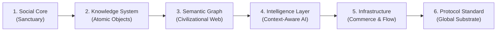

> Canonical EKA documentation. Source of truth for product, architecture, trust and delivery decisions.
> Version: 1.0
> Document Owner: Founder / Chief Strategy Officer
> Status: APPROVED

# EKA Blueprint 30 — The Civilizational Infrastructure Thesis

## 1. Executive Summary & The Trillion-Dollar Premise

Most modern consumer technology platforms optimize for external metrics: engagement velocity, reactive outrage, dopamine loops, and advertising impressions. Yet the deepest human needs—meaning, sacred devotion, contemplative peace, lineage preservation, and ethical belonging—remain stranded in fragmented, unverified, or archaic silos.

**EKA’s Thesis:** The platform that successfully maps, verifies, structures, and networks human inner-life knowledge—across traditions, rituals, sacred geographies, and living communities—will become the fundamental **Civilizational Operating System** of the 21st century.

This document outlines the six-stage progression from an intimate social sanctuary to an indispensable global knowledge infrastructure.

---

## 2. The Six-Stage Civilizational Progression

### Stage 1: The Social Core (The Sanctuary)

- **Primary Value:** A calm, aesthetic, reverent space free from algorithmic hysteria where practitioners, seekers, and scholars share reflections, practice daily sadhana, and discover aligned Sanghas.
- **Economic Model:** Free foundational access with a simple ₹499/month ($9/month) EKA Plus subscription for journeys, circles, and deeper practices.
- **Strategic Function:** Solves the cold-start problem by attracting high-trust creators, lineage keepers, and earnest seekers who will seed the knowledge base.

### Stage 2: The Knowledge System (Epistemic Foundation)

- **Primary Value:** Replacing free-for-all forum misinformation with structured **Atomic Knowledge Objects (AKOs)** governed by the 5-Tier Epistemic Standard:
  1. Documented Tradition (Verified canonical sources)
  2. Interpretation (Commentary by recognized scholars)
  3. Opinion & Lived Reflection (Personal subjective experience)
  4. Community Living Practice (Folkways and oral customs)
  5. AI-Assisted Synthesis (Machine summaries requiring provenance)
- **Strategic Function:** Establishes unimpeachable authority and trust. Users do not come just to talk; they come to learn and verify.

### Stage 3: The Semantic Graph (Civilizational Network)

- **Primary Value:** Interconnecting 22 entity types across Hindu, Buddhist, Sikh, Jain, Islamic/Sufi, and Christian traditions:
  `[Deity] ─── practicedThrough ───> [Ritual] ─── situatedAt ───> [Sacred Geography]`
- **Defensibility:** A dense, multi-faith knowledge graph that cannot be scraped or replicated through simple web crawls because it captures oral traditions, vernacular nuances, and localized relationships.

### Stage 4: The Intelligence Layer (Context-Aware AI Engine)

- **Primary Value:** Bounded, hallucinogen-free AI systems that understand cultural context. When an AI agent reasons about spiritual practices, it references EKA's verified knowledge graph rather than raw, noisy internet scrapings.
- **Enterprise Revenue:** API licensing to major foundation model developers (Google, Anthropic, OpenAI) for cultural alignment, religious sensitivity benchmarks, and accurate historical retrieval.

### Stage 5: The Infrastructure Layer (Sacred Commerce & Logistics)

- **Primary Value:** The transactional fabric of the spiritual world:
  - **Marketplace:** 1-on-1 consultations with verified astrologers, priests, meditation masters, and philosophers (10% platform fee).
  - **Pilgrimage Logistics:** Turnkey routing, accommodations, and ritual scheduling for holy journeys (Kashi, Tirupati, Kailash, Camino de Santiago, Bodh Gaya).
  - **Institutional Transparency:** Philanthropic giving (`/give`) with cryptographic receipting and published utilization metrics for temples, mutts, and monasteries.

### Stage 6: The Protocol Standard (Civilizational Commons)

- **Primary Value:** The **Cultural Context Protocol (CCP)** becomes the global open standard for cultural data representation, similar to OpenStreetMap for spatial geography or Wikipedia for general encyclopedia knowledge.
- **Ultimate Moat:** EKA is no longer just a company; it is the civilizational data backbone that anchors artificial intelligence to authentic human spiritual heritage.

---

## 3. The India-to-Global Asymmetry Engine

EKA leverages a unique structural arbitrage between the Global South and Global North:

| Dimension             | India & Southeast Asia (The Source)                                  | US & Global North (The Expansion)                                               |
| :-------------------- | :------------------------------------------------------------------- | :------------------------------------------------------------------------------ |
| **User Role**         | Tradition keepers, living lineages, scholars, ritual specialists     | Seekers of depth, secular mindfulness graduates, diaspora reconnecting          |
| **Market Dynamic**    | High daily ritual frequency, organic cultural immersion              | High willingness to pay, severe loneliness epidemic, spiritual crisis           |
| **Product Focus**     | Panchangam, regional festivals, temple junctions, vernacular texts   | Guided journeys, daily contemplation, sound baths, philosophical study          |
| **Revenue Driver**    | Marketplace bookings, temple giving, ritual kits, micro-transactions | Annual SaaS subscriptions ($99/year), high-ticket retreats, deep study          |
| **Strategic Synergy** | Generates authentic knowledge and living lineage authority           | Generates venture-scale recurring revenue and global technological distribution |

---

## 4. The Four Defensible Moats

1. **The Provenance Moat:** Every claim, ritual, and philosophical assertion is bound to verifiable primary sources. LLMs cannot invent this provenance because sacred manuscripts require paleographic, linguistic, and lineage verification.
2. **The Lineage Endorsement Moat:** Once traditional mutts, temples, ashrams, and scholarly institutions anchor their official digital identity on EKA (`EKA Verified Lineage`), switching costs become near-infinite.
3. **The Graph Density Moat:** As millions of seekers connect their personal practice rhythms (`sadhana_logs`) to canonical concepts, the graph learns which practices sustain human flourishing over years.
4. **The Sacred Reverence Brand Moat:** EKA refuses ads, clickbait, political polarization, and sensationalist outrage. This sacred restraint builds a brand equity that commercial social monopolies cannot emulate without destroying their ad-driven business models.

---

## 5. Conclusion

By treating spiritual knowledge not as casual user-generated content, but as the crowning intellectual achievement of human civilization, EKA constructs a category-defining institution that bridges antiquity with artificial intelligence.
