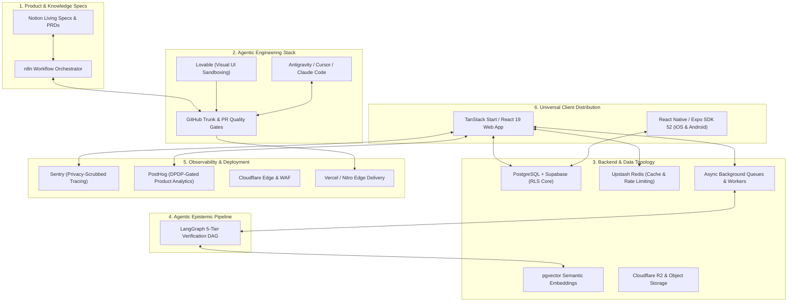

> Canonical EKA documentation. Source of truth for product, architecture, trust and delivery decisions.
> Version: 1.0
> Document Owner: Lead Architect / Founder
> Status: APPROVED

# EKA Blueprint 31 — The Master Workflow & System Integration Blueprint

## 1. Executive Summary & Architectural Vision

Building an institutional-grade, civilizational knowledge system requires seamless harmony between **product ideation**, **agentic coding workflows**, **event-driven orchestration**, **high-performance backend infrastructure**, **AI cognitive pipelines**, and **cross-platform distribution**.

This document unifies the entire technical and operational architecture of EKA into a cohesive, high-velocity engine:



---

## 2. Component Specifications

### 2.1 Developer & Ideation Workflow

1. **Notion (The Living Knowledge Base & Specs):**
   - Canonical home for Product Requirement Documents (PRDs), Knowledge Taxonomy drafts, Epistemic Tier definitions, and sprint epics.
2. **n8n (The Event & Automation Bridge):**
   - Bidirectional webhook synchronizer:
     - Updates in Notion PRDs automatically generate structured GitHub Issues.
     - Merged PRs on GitHub automatically advance Notion ticket statuses.
     - Production deployment webhooks trigger Discord/Slack announcements and changelog updates.
     - Critical community moderation reports trigger emergency triage routing.
3. **Lovable $\leftrightarrow$ Antigravity / Cursor / Claude Code:**
   - **Lovable:** Rapid UI/UX prototyping and interactive component iteration.
   - **Antigravity / Cursor / Claude Code:** Deep full-stack implementation, TanStack Start routing, database migrations, security audits, and agentic refactoring.
4. **GitHub Trunk-Based CI/CD:**
   - `.github/workflows/ci.yml`: Enforces TypeScript type-safety (`npx tsc --noEmit`), linting, and build validation on every PR.
   - `.github/workflows/deploy.yml`: Automated edge deployments to Vercel and Cloudflare with Sentry release tracking.

---

### 2.2 Proper Backend Architecture & Data Topology

1. **Primary Relational Core (PostgreSQL via Supabase / Managed Postgres):**
   - Orchestrated via Drizzle ORM migrations.
   - Strict Row Level Security (RLS) guaranteeing tenant and user data isolation.
   - Separate isolated tables for basic auth (`profiles`) vs. voluntary cultural preferences.
2. **Semantic Vector Store (pgvector):**
   - Dense embeddings generated via OpenAI `text-embedding-3-small` or Gemini embeddings.
   - Powers hybrid search combining PostgreSQL lexical `tsvector` with vector cosine similarity.
3. **Caching & Distributed Rate Limiting (Redis / Upstash):**
   - Located at `src/lib/cache/redis.ts`.
   - Sliding-window rate limiter protecting auth, post creation, and AI API endpoints against abuse.
   - Cache-aside layer for expensive feed aggregations and sacred calendar panchangam calculations.
4. **Asynchronous Background Queues & Workers:**
   - Located at `src/lib/queue/jobs.ts`.
   - Decoupled job processing: media compression (WebP), vector embedding generation, notification fanout, and creator escrow releases.
   - Exponential backoff retry policies and Dead Letter Queue (DLQ) tracking.
5. **Object Storage & CDN (Cloudflare R2 / Supabase Storage):**
   - Encrypted object storage for high-resolution manuscript scans, temple photography, and audio teachings.
   - Pre-signed upload URLs preventing unauthorized direct bucket writes.

---

### 2.3 Agentic Epistemic Pipeline (LangGraph)

Located at `src/lib/ai/langgraph-pipeline.ts`:

- **State Machine DAG:**
  1. `ScriptureParserNode`: Detects sacred terms across Sanskrit, Pali, Tamil, Arabic, and Gurmukhi.
  2. `CitationVerificationNode`: Identifies canonical scripture citations (e.g. _Bhagavad Gita 2.47_, _Yoga Sutras 1.2_).
  3. `ClaimSafetyNode`: Detects prohibited miracle claims, unverified medical cures, or sectarian incitement.
  4. `EpistemicTierCalculatorNode`: Evaluates claims and assigns Verification Levels (L0 unverified to L5 canonical consensus).

---

### 2.4 Observability, Analytics & Privacy Governance

1. **Sentry Error Tracking (`src/lib/observability/sentry.ts`):**
   - Distributed error capture and performance profiling across SSR and client.
   - Mandatory privacy filter (`sanitizePayload`): automatically redacts private journals, sadhana reflections, and authentication tokens before payload dispatch.
2. **PostHog Product Analytics & Feature Flags (`src/lib/observability/posthog.ts`):**
   - Privacy-centric telemetry gated strictly by DPDP affirmative cookie consent (`hasAnalyticsConsent()`).
   - Dynamic feature flag toggles for gradual feature rollouts and A/B experiments.

---

### 2.5 Multi-Cloud Edge Deployment

1. **Cloudflare:**
   - Edge DNS, DDoS mitigation, Web Application Firewall (WAF), and SSL/TLS Full Strict encryption.
   - Global CDN caching of static media and immutable assets.
2. **Vercel & Nitro SSR Delivery:**
   - Server-Side Rendering (SSR) for optimal SEO, instantaneous First Contentful Paint (FCP), and social open-graph previews.

---

### 2.6 Cross-Platform Mobile Client Strategy

Located at `mobile/README.md`:

- **Engine:** React Native with Expo SDK 52 (Fabric New Architecture).
- **Code Sharing:** 95% logic reuse with the web sanctuary (TypeScript types, Supabase client, TanStack Query hooks, Zod schemas).
- **Native Capabilities:**
  - Background audio playback for meditation and sacred soundscapes (`react-native-track-player`).
  - Offline-first encrypted SQLite database (SQLCipher) for private sadhana logs and journals.
  - Zero-tracking local notifications for sacred sunrise/sunset fasting milestones.

---

## 3. Operational Integration Runbook

### Local Development Environment Setup

```bash
# 1. Clone repository and install dependencies
npm install

# 2. Configure environment
cp .env.example .env
# Fill in VITE_SUPABASE_URL, VITE_SUPABASE_PUBLISHABLE_KEY, etc.

# 3. Start local development server with Vite
npm run dev

# 4. Verify build and static types
npx tsc --noEmit
npm run build:dev
```

### Pull Request & Release Procedure

1. Create a feature branch: `git checkout -b feature/sacred-calendar-sync`.
2. Ensure clean quality gates: `npm run lint` and `npm run build:dev`.
3. Open a Pull Request on GitHub using `.github/PULL_REQUEST_TEMPLATE.md`.
4. CI pipeline automatically validates typecheck, lint, build, and secrets.
5. Merging to `main` triggers `.github/workflows/deploy.yml` which deploys to edge and notifies n8n.
