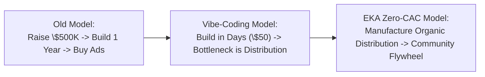
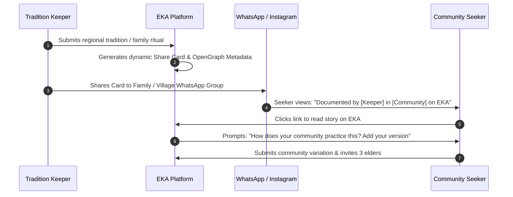

> Canonical EKA documentation. Source of truth for product, architecture, trust and delivery decisions.
> Version: 1.0
> Document Owner: Founder / Growth & Product Lead
> Status: APPROVED

# EKA Blueprint 32 — The ₹0 CAC Growth Engine & 1,000 User Launch Playbook

## 1. Executive Summary & The New Economics of Distribution

In the 2025–2026 software landscape, the cost of software construction has completely collapsed. With modern agentic and AI-assisted development tools (Lovable, Antigravity, Cursor, Supabase, Cloudflare), a production-grade application can be built and deployed for \$30–\$100/month.

However, market data demonstrates that **90–95% of AI-built products fail not because of engineering flaws, but because they have zero organic distribution and customer trust**.



### The New Software Equation:

$$\text{Lean Construction (\$50)} + \text{Painful Cultural Loss} + \text{Polyphonic Community Wedge} + \text{Manufactured Distribution} = \text{Sustainable Network}$$

For EKA, we do not buy attention with paid Facebook or Google ads. We **manufacture distribution** by transforming every piece of sacred knowledge into a shareable community artifact that invites participation.

---

## 2. The Core Strategic Wedge & Audience Targets

We do not launch "culture + spirituality + tourism + ecommerce + wellness" all at once. We launch with **ONE sharp, urgent wedge**:

> **"Discover and preserve authentic traditions, sacred places, and living cultural knowledge — directly from the people who preserve them."**

### 30-Day 1,000 Registered Contributor Breakdown:

| Segment                                        | Target    | Primary Acquisition Channel                  | Core Motivation                                      |
| :--------------------------------------------- | :-------- | :------------------------------------------- | :--------------------------------------------------- |
| **Spiritual & Culturally Curious Seekers**     | 400       | Instagram Knowledge Reels, Quora/Reddit      | Craving authentic depth beyond algorithm noise       |
| **Students & Young Researchers**               | 200       | University NSS, History & Anthropology Clubs | Academic recognition, cultural documentation project |
| **Living Tradition Keepers & Priests**         | 150       | WhatsApp Micro-groups, Temple Outreach       | Lineage preservation, community voice                |
| **Regional Micro-Creators (1K–20K followers)** | 150       | Direct DM recruitment, permanent attribution | Distinctive content, verified EKA creator badge      |
| **Global Indic Diaspora**                      | 100       | Diaspora WhatsApp networks, cultural forums  | Reconnecting children to authentic roots             |
| **Total**                                      | **1,000** | **₹0 Paid Ad Spend**                         | **1,000 Living Cultural Traditions**                 |

---

## 3. The Zero-Cost Viral Flywheel

The product is architected so that **every user action creates the next user's reason to join**:



### The Core Behavioral Rule:

Never ask people to _"Join an app."_ Ask them to **contribute something specific**:

- _"What tradition does your family follow that outsiders don't know about?"_
- _"Document your village's festival before it disappears."_
- _"Tell us the oral legend behind your local temple."_
- _"Add your community's version."_

---

## 4. Key Product Features Supporting Zero-Cost Growth

### 4.1 "Add Your Community's Version" (Polyphonic Multiplier)

- **Implemented at:** [`src/components/app/CommunityVariationModal.tsx`](file:///C:/Users/abhij/OneDrive/Documents/EKA/EKA/src/components/app/CommunityVariationModal.tsx)
- When a user reads about _Diwali Diyas_, _Theyyam_, or _Chhath Puja_, they are prompted:
  `"How is this practiced in your community or village?"`
- When a user contributes their version, one canonical topic instantly branches into 100 regional lineages (Mithila, Garhwal, Kongu Nadu, Konkani, Kashmiri Pandit).
- Each version generates a new indexable page and a new WhatsApp share opportunity.

### 4.2 The WhatsApp & Social Share Card Engine

- **Implemented at:** [`src/components/app/ShareCardModal.tsx`](file:///C:/Users/abhij/OneDrive/Documents/EKA/EKA/src/components/app/ShareCardModal.tsx)
- 1-click formatted WhatsApp message generator with pre-filled cultural attribution:
  `“Did you know this about [Tradition]? In [Community], it is practiced like this... Read and add your version on EKA: [Link]”`
- Native Web Share API integration with automatic referral tracking (`?ref=community_share`).

### 4.3 The "EKA 1,000 Stories" Launch Campaign

- **Implemented at:** [`src/routes/stories.tsx`](file:///C:/Users/abhij/OneDrive/Documents/EKA/EKA/src/routes/stories.tsx)
- A public national preservation challenge: **1,000 people. 1,000 traditions. 1 living cultural archive.**
- Live milestone counter tracking submissions across 6 regional pioneer tracks.
- Every contributor earns the permanent **"EKA Founding Contributor"** badge on their profile.

---

## 5. Channel-by-Channel Execution Plan

### Channel 1: WhatsApp Micro-Groups (Target: 500 Users)

- **Do not spam existing public groups.**
- Form **20 focused micro-groups** (max 25 people each) around high-affinity niches:
  1. _Northeast Folk Traditions_
  2. _Bengal Shakta Lore_
  3. _South Indian Temple Architecture & Agamas_
  4. _Himalayan Sacred Geography & Pandav Nritya_
  5. _Varkari & Bhakti Saints_
  6. _Sacred Food & Prasadam Recipes_
  7. _Kashmir Shaivism Study Circle_
  8. _Diaspora Cultural Roots (US/UK/Canada)_
- Offer value to group admins: _"We are creating a dedicated digital knowledge page for your community on EKA with permanent attribution."_

### Channel 2: 100 "EKA Founding Contributors" Outreach (Target: 250 Users)

- Identify 100 micro-creators, priests, regional historians, and folklore researchers (1K–20K followers on Instagram/X).
- **Pitch:** No sponsorship money; offer permanent digital lineage attribution, verified badge, and featured placement in the national archive.
- Formula: 100 contributors $\times$ 10 referral registrations = 1,000 users.

### Channel 3: College Documentation Challenge (Target: 150 Users)

- Partner with college cultural clubs, NSS units, and Anthropology/History departments.
- Launch the **"Student Cultural Documentation Fellowship"**:
  - Each student documents 1 living oral ritual from their grandparents or local village.
  - EKA grants digital certificates of cultural preservation.

### Channel 4: Instagram & YouTube Shorts Knowledge Hooks (Target: 100 Users)

- Format: High-curiosity, 15-second visual knowledge reels:
  - **0–3s (Hook):** _"Why do Bengalis blow the conch three times during weddings?"_
  - **4–10s (Explanation):** The specific scriptural and regional significance.
  - **11–15s (CTA):** _"Does your community do it differently? Add your version on EKA."_
  - Direct bio link points to `/stories` or the specific tradition permalink.

---

## 6. The 30-Day Launch Sprint Calendar

```
Days 1–3   : Founder network & intimate private community onboarding (50 users)
Days 4–7   : Seed first 20 WhatsApp micro-groups with 10 traditions each (150 users)
Days 8–14  : Outreach to 100 Founding Contributors & Micro-creators (250 users)
Days 15–21 : Launch "EKA 1,000 Stories" campaign + Instagram Reels series (250 users)
Days 22–27 : University NSS & Student Documentation Challenge (150 users)
Days 28–30 : UGC "Add Your Version" viral referral flywheel kicks in (150 users)
---------------------------------------------------------------------------------
TOTAL:       1,000 Active, Culturally Invested Founding Contributors (₹0 Ad Spend)
```

---

## 7. The Ultimate Success Metric

We do not optimize for **1,000 hollow user accounts**. We optimize for **1,000 people who each have an authentic reason to return**:

- A tradition they personally documented.
- A community whose heritage they are stewarding.
- A daily sacred rhythm that brings calm to their inner life.

This is how 1,000 founding contributors compound into 10,000 $\rightarrow$ 100,000 $\rightarrow$ 1,000,000 practitioners.
