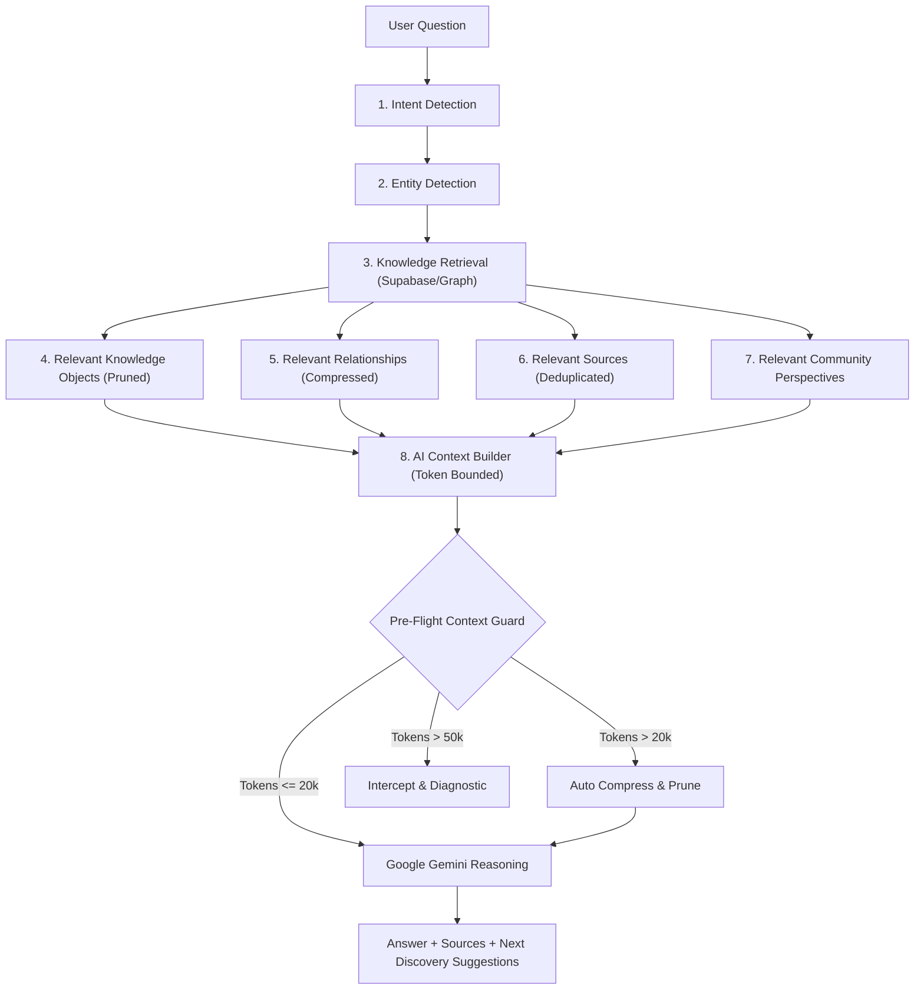

# EKA Blueprint 33: AI Token & Context Utilization Architecture

**Document ID:** `BLU-033` / `33_AI_TOKEN_AND_CONTEXT_UTILIZATION_ARCHITECTURE.md`  
**Version:** 1.0  
**Status:** APPROVED & MANDATORY  
**Date:** 2026-10-06  
**Owner:** Founder / Principal AI Architect & Core Engineering Team  
**Related Documents:**
- [docs/05-technology/TECHNICAL_ARCHITECTURE.md](../05-technology/TECHNICAL_ARCHITECTURE.md)
- [docs/blueprint/07_KNOWLEDGE_GRAPH.md](./07_KNOWLEDGE_GRAPH.md)
- [docs/blueprint/37_AI_INTERACTIVE_INTELLIGENCE_LAYER.md](./37_AI_INTERACTIVE_INTELLIGENCE_LAYER.md)
- [docs/blueprint/40_EKA_AGENTIC_OPERATING_SYSTEM_AND_CAPABILITY_MATRIX.md](./40_EKA_AGENTIC_OPERATING_SYSTEM_AND_CAPABILITY_MATRIX.md)
- [docs/blueprint/42_EKA_X_GOOGLE_ECOSYSTEM_AND_AI_STACK_INTEGRATION.md](./42_EKA_X_GOOGLE_ECOSYSTEM_AND_AI_STACK_INTEGRATION.md)

---

## 1. Executive Summary: The Architectural Invariant

During earlier prototyping, unconstrained context accumulation triggered:
```http
HTTP 400 Bad Request
"The input token count exceeds the maximum number of tokens allowed 1048576."
```

This error is **categorically treated as an architectural defect**, not a transient failure to be resolved by blind retries.

Under no circumstances should the entire EKA codebase, the complete cultural database, unpruned media files, or unbounded multi-turn conversation logs be dumped into an LLM context window.

EKA AI strictly enforces the foundational hierarchy:

$$\begin{aligned}
\text{Supabase} &\longrightarrow \text{Source of Truth (PostgreSQL + RLS + Structured Schemas)} \\
\text{Vector / Semantic Search} &\longrightarrow \text{Targeted Retrieval Layer} \\
\text{Knowledge Graph} &\longrightarrow \text{Entity Relationships \& Provenance Chains} \\
\text{Provenance Layer} &\longrightarrow \text{Epistemic Trust \& Citation Verification} \\
\text{Context Builder} &\longrightarrow \text{Token-Bounded Compression \& Pruning} \\
\text{LLM (Google Gemini)} &\longrightarrow \text{Reasoning, Synthesis \& Contemplative Explanation} \\
\text{Frontend} &\longrightarrow \text{Presentation, Media Rendering \& Discovery}
\end{aligned}$$

---

## 2. Context Budgets & Hard Ceilings (Section 33.1)

Requests must never approach the 1,048,576 token provider ceiling. Strict internal operational budgets are enforced:

| Task Type Profile | Target Working Budget | Hard Safety Ceiling | Automatic Guard Action |
| :--- | :--- | :--- | :--- |
| **Normal Development Task** | $\le 100,000$ tokens | $100,000$ tokens | Halt $\to$ Create Task Handoff |
| **Large Engineering Task** | $\le 200,000$ tokens | $200,000$ tokens | Halt $\to$ Chunk into Sub-Tasks |
| **AI User Query / RAG Request** | $\le 50,000$ tokens | $50,000$ tokens | Pre-flight guard block $\to$ Diagnostic |
| **Preferred Ask EKA Context** | **$5,000 - 20,000$ tokens** | $50,000$ tokens | Compress $\to$ Deduplicate |
| **Provider Absolute Maximum** | **NEVER APPROACH** | **$1,048,576$ tokens** | Block before network dispatch |

### Automatic Detection Rule
$$\text{IF } \text{estimated\_input\_tokens} > \text{configured\_threshold} \implies \text{STOP} \to \text{SUMMARIZE} \to \text{CHUNK} \to \text{RETRIEVE} \lor \text{START NEW TASK}$$

---

## 3. Codebase Exclusions & Task-Based Code Retrieval (Sections 33.2, 33.3)

Development agents must never load the entire repository as context.

### 3.1 Strict File System Exclusions
The following paths are permanently excluded from agent indexing:
```
node_modules/
.git/
.next/
dist/
build/
coverage/
.cache/
tmp/
logs/
generated/
uploads/
videos/
large images (*.png, *.jpg, *.tiff, *.webp)
APK/ / IPA/
archives (*.zip, *.tar.gz)
deployment artifacts/ (*.vercel/output, etc.)
secret files (*.env*, credentials, private keys)
```

### 3.2 10-Step Task-Based Code Retrieval Protocol
For every engineering task:
1. Identify objective.
2. Identify affected module.
3. Identify required routes.
4. Identify required components.
5. Identify required database tables.
6. Identify required APIs / functions.
7. Retrieve **only relevant files**.
8. Implement.
9. Test.
10. Produce a compact summary.

---

## 4. EKA Knowledge Retrieval & RAG Context Limits (Sections 33.4, 33.5)

The cultural knowledge base is never injected wholesale into an AI request.



### 4.1 Retrieval Ranking Priority
When resolving candidate records, ranking strictly follows:
1. **Exact entity match**
2. **Exact question / topic match**
3. **High-confidence Knowledge Objects** ($\ge 0.85$)
4. **Primary / institutional sources** (Tiers 1 & 2)
5. **Scholarly sources**
6. **Community-verified information**
7. **Relevant regional variations**
8. **Related knowledge**

Initial retrieval is bounded by relevance and token budget (preferred top 5–10 Knowledge Objects, top 3–10 relevant sources).

---

## 5. Context Compression & Knowledge Object Pruning (Sections 33.6, 33.7)

### 5.1 Pruning Matrix
| Knowledge Object Field | Historical / Origin Inquiry | Practice / Ritual Inquiry | Sources Inquiry | Sent to LLM? |
| :--- | :---: | :---: | :---: | :---: |
| **Identity / Title / Slug** | Yes | Yes | Yes | **Yes** |
| **Summary / One-Liner** | Yes | Yes | Yes | **Yes** |
| **Origin & Philosophical Root** | Yes | Brief | Brief | **Yes** |
| **Regional Variations** | Capped (1-2) | Capped (3-5) | Omitted | **Yes (Capped)** |
| **Sources & Citations** | Yes (Top 4) | Yes (Top 3) | Exhaustive (Top 6) | **Yes** |
| **Provenance & Trust Score** | Yes | Yes | Yes | **Yes (Invariant)** |
| **Media URLs / Images / Videos** | **No** | **No** | **No** | **NEVER** |
| **Creator / Marketplace / Pricing** | **No** | **No** | **No** | **NEVER** |
| **Internal Unverified Metrics** | **No** | **No** | **No** | **NEVER** |

> [!IMPORTANT]
> **Provenance Guarantee**: Never sacrifice source IDs, verification status, or citations merely to reduce token usage. Strip redundant prose, whitespace, and media references instead.

---

## 6. The 10,000+ Question Corpus Architecture (Section 33.8)

The question corpus is stored in Supabase (`public.question_corpus`) with semantic and intent indexes. It is never loaded into prompt context in its entirety.

Used exclusively for:
- Intent classification
- Semantic query matching
- Suggested follow-up curiosities
- Query expansion and FAQ matching

---

## 7. Content Multiplication & Media Rules (Sections 33.9, 33.10, 33.11)

- **Canonical Relationship**: All generated articles, stories, carousels, reels, maps, and Ask EKA answers reference the single underlying `knowledge_object_id`. Independent duplicates of cultural facts are forbidden.
- **Media Assets**: The LLM reasons over descriptive metadata, attribution, rights status, and cultural locus. Media rendering is decoupled to the frontend client.
- **Cultural Map**: Operates through geographic query filtering (`Location` $\to$ `Entities` $\to$ `Knowledge Objects` $\to$ `Context`).

---

## 8. Rolling Conversation Memory (Section 33.12)

Multi-turn Ask EKA sessions must not accumulate complete prior Q&A dialogues.

The `ConversationMemoryManager`:
- Retains only the last 2–3 turns in active dialogue.
- Distills prior turns into a rolling 1–2 sentence digest (`priorConclusionsSummary`).
- Tracks active entities, topic focus, and user constraints.
- Prevents context size from expanding linearly with conversation depth.

---

## 9. Automatic Context Guard & Token Monitoring (Sections 33.13, 33.14, 33.16)

Before any request reaches the Google Generative Language API or Lovable Gateway:

```ts
const guard = inspectContextGuard({
  prompt,
  systemInstruction,
  taskType: "ask_eka",
  maxBudget: 20_000,
});

if (!guard.allowed) {
  // Hard intercept: prevent HTTP 400
  return abortWithDiagnostic(guard.diagnosticMessage);
}
```

Every request records telemetry to `public.ai_token_logs`:
- `request_id`, `model`, `task_type`
- `estimated_input_tokens`, `actual_prompt_tokens`, `actual_completion_tokens`, `total_tokens`
- `latency_ms`, `cost_estimate_usd`
- `status` (`success`, `guard_intercepted`, `compressed`, `failed`)
- Diagnostic breakdown: System, Knowledge, Conversation, Repository, User query.

### Founder Admin Telemetry
Exposed live at `/founder-admin/ai-context` and in Operations Radar:
- Avg, P50, P95, and Max Input Tokens
- Context-Limit Failures (Target: **0**)
- Estimated Daily Spend ($USD)
- Live request stream with expandable diagnostics.

---

## 10. Development Context Guard & Task Handoff Protocol (Section 33.15)

When repository operations exceed the 100,000 token working ceiling, the agent stops and emits a structured handoff:

```markdown
## TASK HANDOFF
Objective: [Specific goal]
Current state: [Accomplished state]
Files changed: [List of files]
Files requiring attention: [Next targeted files]
Errors: [Any blocking errors]
Tests: [Status of unit/smoke tests]
Next action: [Exact next operation]
```

This prevents carrying massive previous session contexts into subsequent engineering steps.
