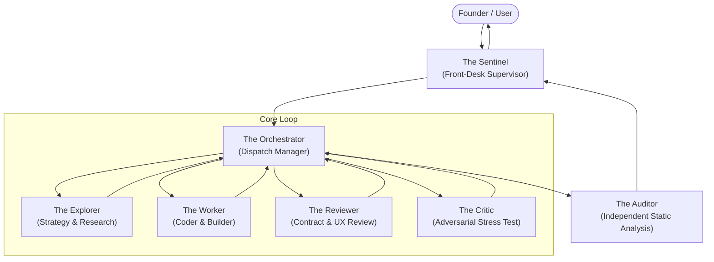

# EKA — Multi-Agent Teamwork Architecture & Autonomous SDLC Engine

**Document:** 34_MULTI_AGENT_TEAMWORK_ARCHITECTURE.md  
**Version:** 1.0  
**Status:** APPROVED  
**Related Documents:**

- [01_MASTER_SYSTEM_ARCHITECTURE.md](file:///c:/Users/abhij/OneDrive/Documents/EKA/EKA/docs/blueprint/01_MASTER_SYSTEM_ARCHITECTURE.md)
- [32_PRODUCTION_DEPLOYMENT_OBSERVABILITY_ARCHITECTURE.md](file:///c:/Users/abhij/OneDrive/Documents/EKA/EKA/docs/blueprint/32_PRODUCTION_DEPLOYMENT_OBSERVABILITY_ARCHITECTURE.md)
- [33_VERCEL_GO_LIVE_DEPLOYMENT_GUIDE.md](file:///c:/Users/abhij/OneDrive/Documents/EKA/EKA/docs/blueprint/33_VERCEL_GO_LIVE_DEPLOYMENT_GUIDE.md)

---

## 1. Executive Summary

To build and maintain a mission-critical platform combining sacred knowledge integrity, social interaction, and financial transactions, EKA adopts a specialized multi-agent hierarchy. Instead of a single monolithic AI assistant attempting to handle planning, implementation, adversarial testing, and security auditing within a single degraded context, tasks are decomposed across seven specialized subagents with explicit separation of powers.

---

## 2. Specialized Subagent Roster

| Role                 | Classification            | Permissions              | Mandate & Constraints                                                                                                                                                                             |
| :------------------- | :------------------------ | :----------------------- | :------------------------------------------------------------------------------------------------------------------------------------------------------------------------------------------------ |
| **The Sentinel**     | Front-Desk Manager        | Read-only, Subagents     | Structures raw user intent into verifiable technical milestones. Supervises execution health, triggers heartbeat crons, and delivers unvarnished summaries to the founder. **Never writes code.** |
| **The Orchestrator** | Dispatch Manager          | Subagents, Handoff Files | Breaks milestones into dependency graphs. Tracks cumulative spawn counts. Dispatches work to Explorer, Worker, Reviewer, and Critic. **Never writes application code or builds directly.**        |
| **The Explorer**     | System Strategist         | Read-only                | Analyzes codebases, database schemas, API specs, and execution logs to author formal strategy specifications for the Orchestrator.                                                                |
| **The Worker**       | Implementation Engineer   | Read/Write/Exec          | Implements concrete TypeScript code, SQL migrations, components, and configs adhering to Explorer strategies. Runs linters, type checks, and tests.                                               |
| **The Reviewer**     | Quality Inspector         | Read-only                | Independently reviews Worker diffs for contract adherence, accessibility (WCAG AA), responsive styling, and architectural consistency.                                                            |
| **The Critic**       | Adversarial Stress Tester | Read/Write/Exec          | Probes for gaps in coverage, race conditions, edge-case failure modes, rapid re-renders, and network fault resilience.                                                                            |
| **The Auditor**      | Static Verification Agent | Read-only                | Combats LLM laziness. Performs deep static analysis to ensure implementations represent real business logic rather than hardcoded facades or mock test bypasses.                                  |

---

## 3. Operational Primitives & Anti-Failure Patterns

### 3.1 Self-Succession (Context Window Optimization)

Large-scale audits and refactors inevitably exhaust model context windows. The Orchestrator maintains an internal spawn counter. Upon hitting threshold (e.g. 8 subagent invocations or 70% context occupancy):

1. The Orchestrator serializes active progress, dependency graphs, and outstanding milestones into `.agent/handoff.json`.
2. Terminates background child processes safely.
3. Invokes a successor Orchestrator subagent seeded with the handoff pointer.
4. The parent Orchestrator exits cleanly, preserving subagent responsiveness and eliminating context degradation.

### 3.2 Heartbeat Crons (Stuck Process Recovery)

Long-running builds, compilation deadlocks, or blocked I/O can stall autonomous teams:

- The Sentinel configures recurring cron schedules (`schedule` primitive).
- Subagents touch heartbeat files (`.agent/heartbeat_<id>.ts`) upon completing steps.
- If a subagent process fails to advance within the timeout threshold, the Sentinel detects the stale timestamp, sends a termination signal, and respawns the worker.

### 3.3 The Auditor Gate (Anti-Cheating & Mock Facade Detection)

To guarantee production authenticity:

- When the Orchestrator marks milestones as complete, work cannot be returned to the Sentinel or user without an **Auditor Certificate**.
- The Auditor inspects test files for trivially true assertions (e.g. `expect(true).toBe(true)`), mock data injections that bypass actual RPC/database calls, and commented-out validations.
- Work is rejected back to the Orchestrator if superficial shortcuts are detected.

---

## 4. Verification Pipeline

All changes delivered by the Worker are validated through the three-gate verification pipeline:

1. **Gate 1: Compiler & Linter Verification**
   - `npx.cmd tsc --noEmit` (0 errors)
   - `npx.cmd eslint src --rule "prettier/prettier: off"` (0 errors)
2. **Gate 2: Autonomous Browser Verification**
   - Playwright E2E suite (`npx.cmd playwright test`)
   - Chrome DevTools MCP visual inspection & DOM accessibility snapshots
3. **Gate 3: Production Build Verification**
   - `npm.cmd run build` (Nitro `.vercel/output` generation verified)
