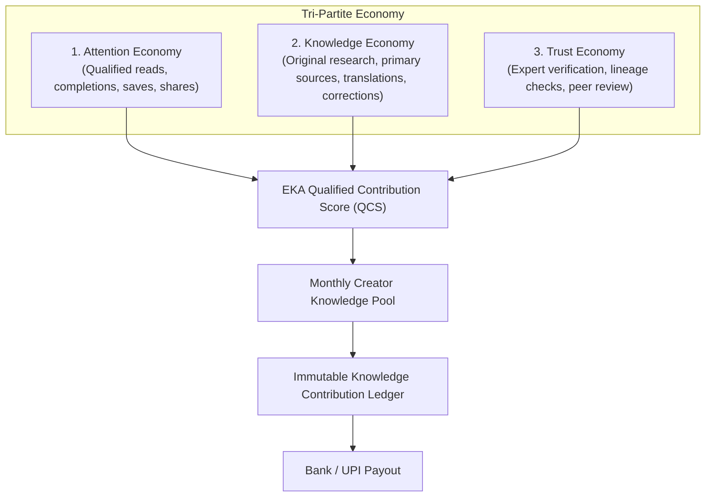
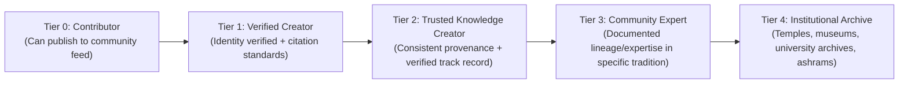

# EKA — Creator Economy & Payout Engine v1

**Document:** 35_CREATOR_ECONOMY_AND_PAYOUT_ENGINE.md  
**Version:** 1.0  
**Status:** APPROVED  
**Related Documents:**

- [01_MASTER_SYSTEM_ARCHITECTURE.md](./01_MASTER_SYSTEM_ARCHITECTURE.md)
- [30_EKA_INFRASTRUCTURE_THESIS.md](./30_EKA_INFRASTRUCTURE_THESIS.md)
- [31_WORKFLOW_AND_SYSTEM_INTEGRATION.md](./31_WORKFLOW_AND_SYSTEM_INTEGRATION.md)
- [ANTIGRAVITY_OPERATING_INSTRUCTIONS.md](../05-technology/ANTIGRAVITY_OPERATING_INSTRUCTIONS.md)

---

## 1. Executive Summary & The Tri-Partite Economy

Traditional social media monetizes raw, unverified attention:
$$\text{YouTube / TikTok:} \quad \text{Ad View / Impression} \longrightarrow \text{Monetization}$$

EKA rejects direct "1 Like = ₹X" or view-count models, which incentivize engagement bait, outrage, and bot farming. Instead, EKA pioneers the **Tri-Partite Economic Engine**:



---

## 2. EKA Qualified Contribution Score (QCS)

Contributions accumulate points based on a multi-signal algorithmic evaluation rather than superficial reactions:

| Signal Category                 | Signal Components                                                             | Weight  | Economic Rationale                                    |
| :------------------------------ | :---------------------------------------------------------------------------- | :-----: | :---------------------------------------------------- |
| **Qualified Consumption**       | Verified scroll depth, dwell time ($\ge 45\text{s}$), journey step completion | **25%** | Rewards genuine absorption over bounce traffic        |
| **Active Curation**             | Long-term saves, collections, internal/external shares                        | **20%** | Measures enduring pedagogical or spiritual utility    |
| **Meaningful Discussion**       | Thoughtful comments ($\ge 30$ chars), community discourse                     | **15%** | Incentivizes contemplative community dialogue         |
| **Source Quality & Provenance** | Primary scripture/archival citations, bibliography links                      | **15%** | Directly rewards academic & historical fidelity       |
| **Verification & Trust**        | Peer verifier validation, lineage confirmation, zero disputes                 | **15%** | Incentivizes contributors to submit verifiable truths |
| **Repeat Learning**             | Return visits, multi-day reference, devotional streak integration             | **5%**  | Measures long-term habit formation                    |
| **Surface Reactions**           | Likes, hearts, initial taps                                                   | **5%**  | Retains social feedback while capping bot incentives  |

$$\text{QCS}_i = 0.25 C_i + 0.20 S_i + 0.15 D_i + 0.15 P_i + 0.15 V_i + 0.05 R_i + 0.05 L_i$$

---

## 3. The Monthly Creator Knowledge Pool Model

Instead of promising fixed cost-per-impression (CPM), EKA operates an economically sustainable monthly pool:

$$\text{Creator Payout} = \frac{\text{Creator's Qualified Points}}{\text{Total Platform Eligible Points}} \times \text{Net Knowledge Pool}$$

```
Step 1: Gross Platform Inflow (Memberships + Brand + Fan Support + Commerce)
   │
   ▼
Step 2: Less Statutory Deductions (GST + Payment Gateway Fees 2% + Refund Reserve 5%)
   │
   ▼
Step 3: Platform Reinvestment Share (15% - 20%)
   │
   ▼
Step 4: Net Monthly Creator Knowledge Pool Available for Distribution
   │
   ▼
Step 5: Pro-Rata Attribution by Contribution Score to Verified Ledgers
```

### Proposed EKA Revenue Splits

| Monetization Stream                  |  Creator Share   | EKA Platform Share | Reinvestment Allocation                           |
| :----------------------------------- | :--------------: | :----------------: | :------------------------------------------------ |
| **Fan Support / Direct Gratitude**   |     **85%**      |        15%         | Hosting, security & fraud prevention              |
| **Circle Memberships**               |     **85%**      |        15%         | Community moderation & infrastructure             |
| **Courses & Digital Guided Paths**   |     **80%**      |        20%         | Course platform & video delivery                  |
| **Brand Marketplace Collaborations** |     **80%**      |        20%         | Campaign management & escrow settlement           |
| **Sacred Objects / Commerce**        |     **75%**      |        25%         | Curation, logistics API & verification            |
| **Ethical Sponsorships / Ads**       |     **55%**      |        45%         | Sales team, ad tech, publisher servicing          |
| **Knowledge Reward Pool**            | **100% of Pool** |         0%         | Distributed strictly across verified contributors |

---

## 4. Multi-Contributor Knowledge Attribution Ledger

A cultural or spiritual knowledge artifact is rarely created in isolation. EKA's key innovation is the **Polyphonic Knowledge Contribution Ledger**:

```
                       Knowledge Item
          (e.g., "Assamese Satriya Dance & Monastic Rituals")
                             │
       ┌──────────────┬──────┴───────┬──────────────┬──────────────┐
       ▼              ▼              ▼              ▼              ▼
    Creator         Source        Verifier      Community      Translator
(Explains/Films) (Manuscript)  (Scholar/Guru)   Steward        (Assamese->Eng)
     [50%]          [15%]          [15%]          [10%]          [10%]
```

Every participant receives provenance attribution in the knowledge graph and proportionate economic distributions when the artifact earns from the pool.

---

## 5. Creator Reputation & Trust Tiers

Qualification is determined by trust, domain lineage, and contribution history—never by follower vanity counts:



---

## 6. Dual Dashboard Architecture

### 6.1 Contributor Earnings Dashboard (`/app/creator/dashboard`)

- **Key Metrics:**
  - Total Earnings, Pending Balance, Available for Withdrawal.
  - Revenue breakdown: Knowledge Pool, Fan Support, Memberships, Marketplace.
  - Creator Knowledge Score (0–100) & Trust Tier badge.
- **Transparent "Why Did I Earn This?" Ledger:**
  - `+ 1,240` Qualified reading sessions ($\ge 45\text{s}$)
  - `+ 380` Community saves & bookmark additions
  - `+ 170` External quote shares with attribution
  - `+ 12` Peer-reviewed source citations validated
  - `+ 3` Community-verified factual corrections accepted
  - `- 2` Disputed or unsubstantiated claims penalized

### 6.2 Admin Fraud, Risk & Financial Control Center (`/admin/creator-risk`)

- **Invalid Engagement & Bot Mitigation:**
  - Device fingerprint clustering & IP velocity detection.
  - Coordinated engagement ring detection (mutual circular liking loops).
  - Reaction velocity anomalies (e.g. 50 likes in 3 seconds).
- **Financial Controls:**
  - Statutory PAN verification & Indian Tax Deducted at Source (TDS 194J/194C) calculation.
  - Bank Account / UPI VPA penny-drop validation before payout.
  - Mandatory 30-day rolling dispute reserve for new accounts.
  - Automated clawback engine for refund/chargeback events.
- **Provenance & Plagiarism Auditing:**
  - Unattributed scraping detection.
  - Mandatory AI-content disclosure tag validation.

---

## 7. Event-to-Payout Processing Pipeline

```
[ User Interaction ]
         │
         ▼
[ Immutable Event Log ] (Public raw engagement events)
         │
         ▼
[ Anti-Fraud & Qualification Filter ] (Rejects bots, rapid duplicate clicks)
         │
         ▼
[ Qualified Engagement Records ] (Dwell verified, unique sessions)
         │
         ▼
[ Monthly QCS Aggregator ] (Calculates weightings per content & contributor)
         │
         ▼
[ Monthly Knowledge Pool Close ] (Allocates net pool to contributor ledgers)
         │
         ▼
[ Contributor Earnings Ledger ] (Append-only credits)
         │
         ▼
[ Compliance & TDS Review ] (PAN check, 1% / 10% tax withholding)
         │
         ▼
[ Payout Batch Execution ] (Direct RazorpayX / Cashfree bank payout)
```
