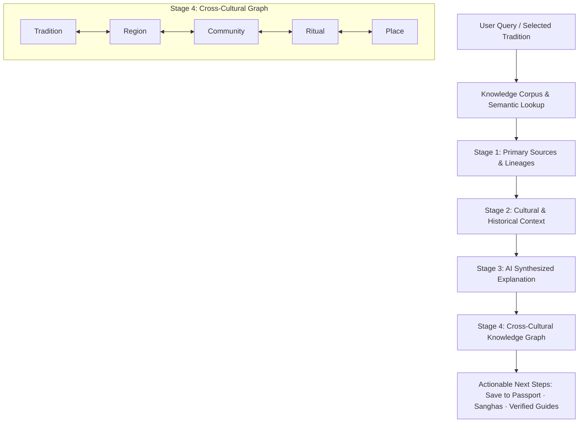

# EKA Blueprint 37: AI Interactive Intelligence Layer ("Ask EKA")

**Document ID:** `BLU-038`  
**Status:** Approved & Implemented  
**Date:** 2026-09-27  
**Owner:** Founder / Product Architect & Principal Engineer

---

## 1. Executive Summary

EKA is not a static content library, nor an indiscriminate AI chatbot. The **AI Interactive Intelligence Layer ("Ask EKA")** transforms historical and spiritual repositories into a dynamic, cross-culturally connected intelligence interface.

Rather than synthesizing unverified probabilistic assertions, Ask EKA enforces a strict 4-stage pipeline:
$$\text{Primary Sources \& Lineages} \longrightarrow \text{Cultural \& Historical Context} \longrightarrow \text{Synthesized AI Explanation} \longrightarrow \text{Cross-Cultural Knowledge Graph}$$

Members can query any tradition, origin, or regional variation and immediately observe how sacred rituals, seasonal celebrations, and contemplative practices interconnect across geographies without sectarian bias.

---

## 2. Core Inquiries & Question Taxonomy

The interface supports four fundamental inquiries:

1. **"What is this tradition?"**
   - Definitive, respectful, non-sectarian conceptual grounding.
   - Clarifies philosophical foundations (e.g. _Rta_ cosmic reciprocity, _Sandhi_ juncture contemplation, _Prema_ egalitarian love).
2. **"Where did it originate?"**
   - Geographical roots, historical era (e.g. Late Bronze Age, Sangam era, medieval Bhakti renaissance).
   - Custodian communities, languages of origin, and preservation status.
3. **"How is it practiced differently across regions?"**
   - Branches into localized expressions across South Asia and global diaspora.
   - Demonstrates how the same astronomical/solar juncture manifests as Baisakhi in Punjab, Vishu in Kerala, Bohag Bihu in Assam, and Poila Baisakh in Bengal.
4. **"Show me the sources and lineages."**
   - Exhaustive archival proof: canonical scripture title, verse citation, original language script, verified English translation, and validating lineage scholar with verified Trust Score (e.g. 98%).

---

## 3. Four-Stage Pipeline Architecture



### 3.1 Data Schema

```ts
// src/lib/ai-knowledge.ts
export interface AskEkaKnowledgeResult {
  query: string;
  traditionName: string;
  inquiryType: "what_is" | "origin" | "regional_variations" | "sources" | "general";
  sources: PrimarySource[];
  context: CulturalContext;
  aiExplanation: {
    summary: string;
    deepExplanation: string;
    nuanceNotes: string;
    philosophicalUnderpinning: string;
  };
  crossCulturalGraph: {
    primaryNode: KnowledgeGraphNode;
    connections: RegionalVariation[];
    lineageChain: string[];
  };
  relatedSanghas: Array<{ name: string; slug: string; membersCount: number }>;
  verifiedGuides: Array<{ name: string; slug: string; specialty: string; rating: number }>;
}
```

---

## 4. Cross-Cultural Discovery Graph: Tradition ↔ Region ↔ Community ↔ Ritual ↔ Place

Cultural knowledge must never be presented in isolation. The cross-cultural discovery graph links 5 core entities:

1. **Tradition:** The archetypal spiritual or cultural discipline (e.g. Solar Harvest Thanksgiving, Twilight Juncture Meditation, Devotional Chanting).
2. **Region:** The ecological and cultural territory (e.g. Braj, Malabar, Brahmaputra Valley, Deccan, Kashmir).
3. **Community:** The custodians living the practice (e.g. Warkari pilgrims, Assamese Namghar stewards, Kaveri riverline Smarthas).
4. **Ritual:** The tangible human action (e.g. Vishukkani dawn viewing, Goru Bihu cattle blessing, Sandhya Arghya solar offering).
5. **Place:** The physical geography or sanctum (e.g. Pandharpur, Majuli Island, Golden Temple, Thanjavur).

---

## 5. Member Experience & Integration Points

1. **Embedded in Explore Route (`/_authenticated/app/explore`):** Positioned prominently above topics so members can immediately query traditions and compare regional variations.
2. **Interactive Drawer (`AskEkaDrawer`):** Quick inquiry chips, topic suggestions, tabbed inspection, and responsive design.
3. **Wisdom Passport Sync:** One-tap save to personal Wisdom Passport, preserving primary sources and study notes.
4. **Community & Guide Handoff:** Direct links to join active Sanghas and connect with verified lineage guides.
