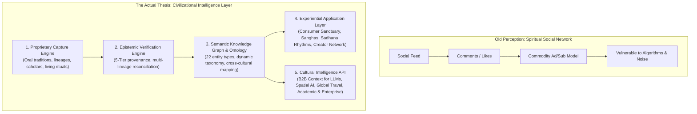
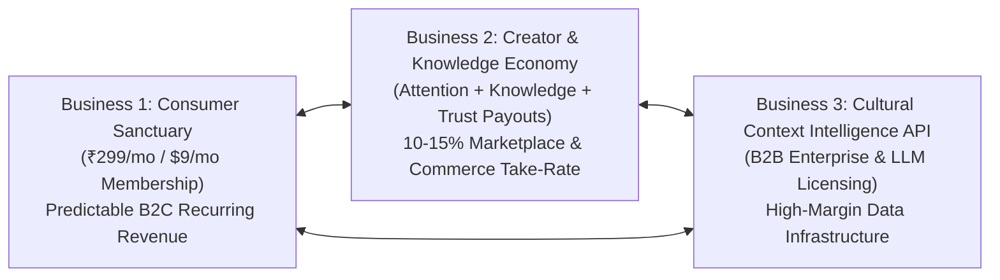
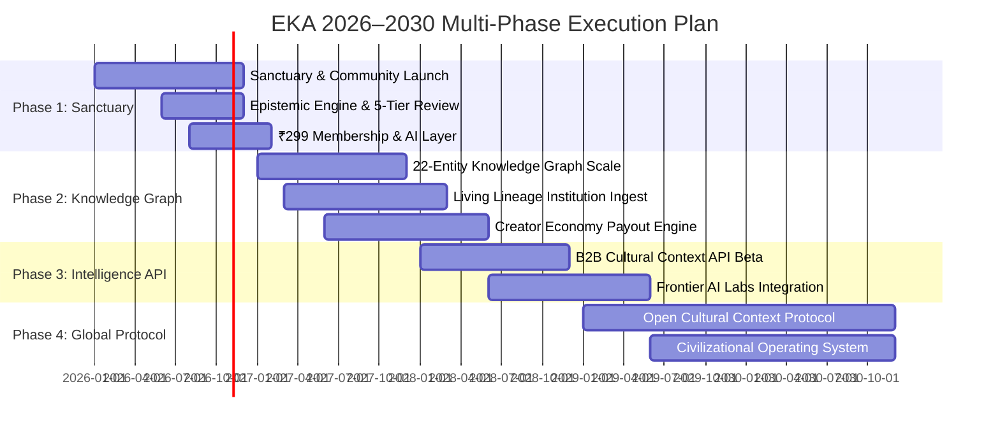

> Canonical EKA documentation. Source of truth for product, architecture, trust and delivery decisions.
> Version: 1.0
> Document Owner: Founder / Chief Strategy Officer / Investor Syndicate
> Status: APPROVED
> Index: BLU-039

# EKA Blueprint 38 — Turning the $1B Thesis into an Investable Category-Defining Company: The Trusted Cultural & Human Context Intelligence Layer

---

## 1. The Fundamental Strategic Shift



**The Core Realization:**
EKA is **not** a spiritual social network.
EKA is a **Trusted Intelligence Layer for Culture, Community, Place, and Local Knowledge — with a Social Network and Living Practice on top.**

The social network is the discovery, participation, and contribution engine.
The **unassailable economic moat** is the structured, provenance-rich, multi-tradition Knowledge Graph and Epistemic Engine constructed underneath it.

---

## 2. The 5-Layer Architectural Stack

| Layer                   | Functional Architecture                                                                                                                    | Economic & Strategic Asset                                                                                                                         | Defensibility / Moat                                                                                       |
| :---------------------- | :----------------------------------------------------------------------------------------------------------------------------------------- | :------------------------------------------------------------------------------------------------------------------------------------------------- | :--------------------------------------------------------------------------------------------------------- |
| **1. Capture**          | Mobile sadhana logs, voice-first oral histories, ethnographic submissions, lineage archival ingest, vernacular community discussions.      | **Proprietary Raw Cultural Inflow:** Data that exists nowhere on the public internet, trapped in vernacular dialects and oral memory.              | High friction of physical and vernacular collection; impossible to scrape via generic web crawlers.        |
| **2. Verify**           | 5-Tier Epistemic Standard, cross-lineage source grounding, community and peer-expert review, lineage seals of endorsement.                 | **High-Fidelity Trust Fabric:** Zero-hallucination verification separating canonical tradition from subjective interpretation and living folkways. | Social proof and institutional mutt/temple validation cannot be bought or synthetic-generated.             |
| **3. Structure**        | 22-entity dynamic graph (Tradition ↔ Place ↔ Ritual ↔ Deity ↔ Text ↔ Rhythm ↔ Community), vector embeddings + deterministic graph triples. | **Civilizational Semantic Ontology:** The machine-readable substrate of human spiritual and local context.                                         | Extreme graph density and network effects; exponentially more valuable as nodes and edges compound.        |
| **4. Experience**       | Consumer App, Sangha spaces, ₹299/mo membership, personalized sadhana loops, interactive AI intelligence queries, community marketplace.   | **Direct User Retention & Creator Economy:** High engagement, calm daily return habits, multi-sided network effects.                               | Sacred aesthetic restraint; community trust; high switching costs due to personal sadhana journey history. |
| **5. Intelligence API** | B2B API, GraphQL endpoints, Retrieval-Augmented Generation (RAG) connectors for LLMs, contextual location feeds for spatial computing.     | **Recurring Enterprise Revenue:** High-margin B2B data licensing to OpenAI, Google, Anthropic, Apple, Meta, travel, and cultural bodies.           | Sole provider of clean, culturally grounded, verified human context without toxic training hallucinations. |

---

## 3. The Civilizational Problem EKA Solves

Modern internet architectures have catastrophically failed cultural, spiritual, and local wisdom:

1. **Wikipedia's Secular & Encyclopedic Bias:**
   - Wikipedia enforces a narrow "neutral point of view" (NPOV) derived from Western secular academic publications, completely ignoring living oral traditions, regional temple lineages, and experiential meditative states.
   - It is static, text-only, and lacks any relationship to calendar rhythms, daily practice, or living communities.

2. **Reddit & Twitter's Outrage Architecture:**
   - Ad-driven algorithms optimize for conflict, sectarian provocation, and memeification.
   - Sacred topics instantly devolve into low-signal comment wars, dogmatism, and trolling.

3. **YouTube & TikTok's Sensationalism:**
   - Creators are incentivized to produce clickbait, superstitious fear-mongering, and commercialized mysticism to feed the recommendation algorithm.
   - Zero epistemic accountability or source attribution exists.

4. **Frontier AI's "Cultural Hallucination" Crisis:**
   - Foundation models (GPT-4, Claude, Gemini) are trained on unstructured, noisy, predominantly Western internet dumps.
   - When queried on Vedic rites, Buddhist vinaya nuances, Sufi maqamat, or localized tribal customs, models hallucinate, conflate opposing theological schools, or produce bland, sanitized caricatures.
   - **EKA solves the ground-truth problem for the AI era.**

---

## 4. The Three Synergistic Businesses Inside EKA



### Business Unit 1: The Consumer Sanctuary (B2C SaaS)

- **Offering:** ₹299/month ($9/month) EKA Membership.
- **Value Proposition:** Interactive AI cultural intelligence, daily faith-aware sadhana calendar, ad-free sanghas, structured pathways, sacred travel routes.
- **Unit Economics:** 85%+ gross margin; negative churn driven by personal reflection history and peer sangha accountability.

### Business Unit 2: The Creator & Living Knowledge Marketplace (Platform Commerce)

- **Offering:** 1-on-1 consultations with verified scholars, meditation masters, astrologers, and spiritual mentors; physical ritual objects; guided pilgrimages.
- **Monetization:** 10% platform take-rate on services; 15% on physical goods and curated journeys.
- **Flywheel:** Payout engine redistributes rewards across **Attention** (engagement), **Knowledge** (research & archival ingest), and **Trust** (expert verification & moderation).

### Business Unit 3: The Cultural Context Intelligence API (Enterprise Infrastructure)

- **Offering:** High-speed API access, embeddings, and RAG grounding for enterprise LLM developers, autonomous travel agents, museum curations, and gaming/entertainment worldbuilders.
- **Contract Value:** $50,000 to $2,000,000+ annual recurring licenses for major foundational AI labs requiring bias correction, cultural alignment, and factual religious grounding.

---

## 5. Strategic Evaluation Across Industry Titan Lenses

### The Steve Jobs Lens: Simplicity, Reverence, and Transcendent Taste

> _"Simplicity is about subtracting the obvious and adding the meaningful."_

- **Focus:** EKA must not feel like software; it must feel like stepping into a tranquil cathedral or an ancient stone temple.
- **Execution:**
  - Ruthless minimalism in typography (Fraunces + Karla), bespoke sacred geometry (the EKA 12-petaled mandala), and earth-pigment color palettes (saffron, terracotta, sand, forest).
  - Every interaction—from a morning breath timer to a verified scripture citation—must evoke stillness, reverence, and emotional dignity.
  - Zero pop-ups, zero intrusive ads, zero manipulative notification badges.

### The Elon Musk Lens: First Principles Physics & The Machine That Builds The Machine

> _"Boil things down to their fundamental truths and reason up from there."_

- **Focus:** What is the fundamental unit of cultural intelligence?
- **Execution:**
  - The atomic unit is the **Atomic Knowledge Object (AKO)**: a single factual, ritual, or philosophical claim bound to a verified source, spatial coordinate, and temporal calendar rhythm.
  - Automate the ingestion, extraction, and verification pipeline so that 10,000 distributed contributors can feed the ontology at near-zero marginal cost.
  - Build an unassailable data flywheel: Every user query and validation sharpens the graph, creating an accelerating gap that no competitor can cross without years of manual field-level ground work.

### The Mark Zuckerberg Lens: Graph Topology, Retention Loops, and Network Density

> _"The best products connect people to what matters most to them."_

- **Focus:** How do we drive compounding retention and viral organic expansion without relying on toxic outrage?
- **Execution:**
  - Construct the **Human Context Graph**: Connecting seekers not just by demographic proxies, but by shared spiritual inquiry, sadhana commitments, and geographic pilgrimage routes.
  - Double-sided retention loops: A daily sadhana streak reinforces the morning routine; a weekly circle gathering reinforces communal belonging; a monthly seasonal festival anchors the year.
  - The Creator-Contributor flywheel: Turning consumers into contributors through low-friction structured prompts (e.g., verifying a local temple history, sharing a family chant variant).

---

## 6. The Tier-1 Venture Capital Investment Committee Memo

```
MEMORANDUM
TO: Investment Committee
FROM: Leading Partner / Emerging Tech & Infrastructure
DATE: September 2026
SUBJECT: Investment in EKA — The Civilizational Intelligence Layer
RECOMMENDATION: Lead Series Seed / Series A Syndicate ($5M - $15M)
```

### Executive Summary

EKA is building the first trusted intelligence infrastructure and community operating system for human spirituality, culture, and localized tradition. By turning messy oral and civilizational heritage into a machine-readable, verified knowledge graph, EKA captures high-margin consumer SaaS, high-frequency transactional commerce, and critical B2B enterprise AI data licensing.

### Market Sizing (TAM Decomposition)

1. **Global Spiritual & Wellness Market:** $1.5 Trillion (Mindfulness, yoga, spiritual travel, devotional goods, astrological services).
2. **Faith & Devotional Tech in India & Southeast Asia:** $50 Billion+ (temple donations, puja bookings, pilgrimage travel, festival economy).
3. **Enterprise AI Grounding & Cultural Context Data Market:** $25 Billion by 2030 (as frontier AI models expand into non-Western languages and localized reasoning).
4. **Target Addressable Opportunity for EKA:** **$35 Billion** obtainable across consumer subscriptions, marketplace commissions, and enterprise data licensing.

### Defensibility & Unfair Advantages

- **Data Asymmetry:** Sacred texts in Sanskrit, Pali, Tamil, Gurmukhi, Arabic, and Tibetan are nuanced and untranslated into clean modern graph schemas. EKA owns the canonical mapping.
- **Institutional Lock-in:** Once centuries-old mutts, ashrams, and temples establish their official identity and spending records on EKA, they cannot migrate.
- **Epistemic Moat:** Big tech cannot crawl living human oral memories. EKA captures them via community creators incentivized by the Knowledge & Trust Payout Pools.

### Unit Economics at Maturity (Per 100K Active Subscribed Users)

- **B2C Recurring Revenue:** 100,000 × ₹299/mo = ₹29.9M/month (~$4.3M ARR) with 88% gross margins.
- **Marketplace Volume:** 100,000 users × ₹500 avg annual transaction volume × 12% take-rate = ₹6M (~$72K ARR).
- **Enterprise API Licensing:** 5 Foundation Model Tier-1 contracts @ $350K/year = $1.75M ARR.
- **Combined Net Revenue:** ~$6.1M ARR per 100K paying cohort at 82% blended gross margin.
- **Path to $100M ARR:** 1.5M paying members + 50 Enterprise API clients + 10% global pilgrimage market share.

---

## 7. Execution Roadmap (2026–2030)



1. **Phase 1 (2026): The Sanctuary & Epistemic Standard**
   - Solidify core web & mobile application.
   - Launch ₹299/mo Membership and Ask EKA AI interactive layer.
   - Reach first 10,000 active sadhana keepers and 250 verified lineage masters.

2. **Phase 2 (2027): Graph Expansion & Creator Economy**
   - Deploy dynamic graph store with 500,000 verified Atomic Knowledge Objects.
   - Activate Attention + Knowledge + Trust Payout Engine.
   - Roll out pilgrimage logistics and temple verification (`/give`).

3. **Phase 3 (2028): The Enterprise Cultural Context API**
   - Launch enterprise API for LLMs, travel platforms, and academic institutions.
   - Partner with major AI labs for cultural alignment and bias elimination benchmarks.

4. **Phase 4 (2029–2030): The Global Civilizational Standard**
   - Establish the Cultural Context Protocol as the global open data standard.
   - Expand internationally to East Asia, Europe, and the Americas.
   - Prepare for public market listing / category-defining civilizational institution.
