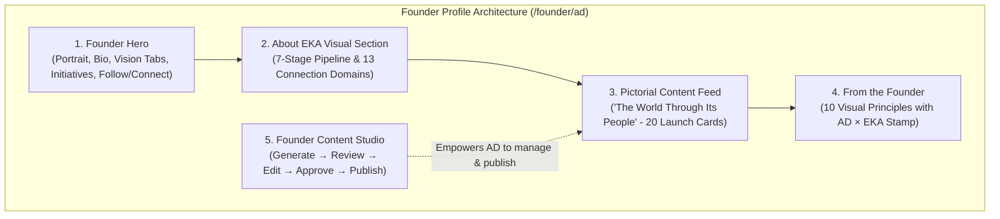

> Canonical EKA documentation. Source of truth for product, architecture, trust and delivery decisions.
> Version: 1.0
> Document Owner: Founder / Chief Technology Officer
> Status: APPROVED
> Index: BLU-040

# EKA Blueprint 39 — Founder Profile, Visual Storytelling & Pre-Generated Pictorial Content Engine

---

## 1. Executive Objective

The founder of EKA, **AD**, should **not need to manually explain EKA repeatedly** whenever interacting with seekers, scholars, creators, or investors.

The dedicated Founder Profile at [`/founder/ad`](file:///c:/Users/abhij/OneDrive/Documents/EKA/EKA/src/routes/founder.ad.tsx) communicates:
1. **Who AD is:** Technologist, systems architect, and cultural preservationist dedicated to building the civilizational intelligence substrate.
2. **What EKA is building:** The trusted intelligence layer for the world's cultures, communities, and local knowledge—with a living practice and creator network on top.
3. **Why EKA exists:** Because human cultural memory is fragmented and threatened by outrage-optimized social feeds and hallucination-prone generic AI models.
4. **How it operates:** Through pre-generated visual cards, 10 founder strategic principles, and an interactive content studio.

---

## 2. Auto-Generated "About EKA" Section

Visitors to the founder profile immediately encounter a self-explanatory visual architecture:

### The 7-Stage Epistemic Cycle
$$\text{Source} \longrightarrow \text{Verify} \longrightarrow \text{Contextualize} \longrightarrow \text{Learn} \longrightarrow \text{Discuss} \longrightarrow \text{Create} \longrightarrow \text{Preserve}$$

1. **Source:** Capturing oral histories, field audio, manuscript scans, and living community practices.
2. **Verify:** 5-Tier Epistemic Audit separating canonical documentation from living folkways, scholarly critique, and subjective reflection.
3. **Contextualize:** Semantic graph interconnection across 22 entity types (geography, seasonal calendars, deity principles, lineages).
4. **Learn:** Interactive AI inquiries (*Ask EKA*) and personalized daily sadhana rhythms.
5. **Discuss:** Ad-free, reverent Sangha circles without outrage algorithms.
6. **Create:** Creator Economy payouts across Attention (35%), Knowledge (40%), and Trust (25%) pools.
7. **Preserve:** Anchoring human cultural context into an open protocol substrate (CCP).

### The 13 Connection Domains
EKA connects thirteen living cultural dimensions, each represented by a dedicated card with image, ontology badge, and real-world examples:
1. **Cultures:** Worldview paradigms (Vedic, Celtic, Berber, Zen, Sufi, Nordic, etc.).
2. **Communities:** Lineages, clans, sanghas, and artisan guilds.
3. **Traditions:** Unbroken generational continuities of philosophy and ethics.
4. **Spirituality:** Experiential inner inquiry, contemplative prayer, and meditation.
5. **Religious Places:** Sacred architectures, sanctums, and pilgrimage nodes.
6. **Local Life:** Everyday rhythms of ghats, courtyards, and morning cleansings.
7. **Tourism & Sacred Travel:** Pilgrimage routes that replace sightseeing with respectful encounter.
8. **Local Brands & Artisans:** Heirloom enterprises preserving ancestral material science.
9. **Creators & Mentors:** Writers, translators, and vocal masters translating ancient depth.
10. **Community Experts:** Village elders, herbalists, genealogists, and pandits.
11. **Local Knowledge:** Vernacular ecological signals, water harvesting, and seasonal foodways.
12. **Historical Knowledge:** Epigraphy, manuscript archives, and chronologies of cultural shifts.
13. **Contemporary Community Knowledge:** Living adaptation of sacred ethics to modern challenges.

---

## 3. Pre-Generated Pictorial Content: "EKA — The World Through Its People"

The feed contains 20 curated launch cards built with high-definition, documentary-style imagery and zero AI cliches:

| # | Dimension | Title | Geographic / Cultural Context | Community Custodian | Epistemic Tier |
| :--- | :--- | :--- | :--- | :--- | :--- |
| **1** | Culture | *A Culture Is More Than a Festival* | Bishnupur & Majuli, India | Terracotta Guilds & Sattra Lineages | Tier 4: Community Practice |
| **2** | Tradition | *Why Traditions Survive Generations* | Thanjavur, India & Kyoto, Japan | Intergenerational Lineage Keepers | Tier 2: Scholarly Commentary |
| **3** | Local Knowledge | *The Knowledge That Never Made It Into a Textbook* | Western Ghats, Maharashtra | Forest Forager & Farmer Collectives | Tier 4: Community Practice |
| **4** | Spirituality | *The Many Ways Humans Search for Meaning* | Jerusalem, Varanasi & Bodh Gaya | Multi-Faith Contemplative Sanghas | Tier 1: Canonical Source |
| **5** | Communities | *Every Community Has a Story* | Kutch, Gujarat & Spiti Valley | Maldhari Pastoralists & Monastic Villages | Tier 4: Community Practice |
| **6** | Places | *A Place Is More Than Its Location* | Varanasi Ghats, Uttar Pradesh | Kashi Teertha Purohit Sabha | Tier 1: Canonical Source |
| **7** | Tourism | *Travel Beyond the Tourist Map* | Camino de Santiago & Narmada | Parikramavasi Pilgrim Networks | Tier 3: Lived Reflection |
| **8** | Local Brands | *The Story Behind a Local Brand* | Aranmula, Kerala & Channapatna | Vishwakarma Metal Casting Guilds | Tier 4: Community Practice |
| **9** | Creator Economy | *Knowledge Can Become a Livelihood* | Global Cultural Economy | EKA Contributor Fellowship | Tier 2: Scholarly Commentary |
| **10** | Verification | *Who Gets to Say What Is Authentic?* | Pan-Indian & Global Lineage Councils | EKA Trust & Epistemic Audit Board | Tier 1: Canonical Source |
| **11** | Sacred Ecology | *The Sacred Grove & River Memory* | Western Ghats & Thar Desert | Bishnoi & Village Panchayats | Tier 4: Community Practice |
| **12** | Living Crafts | *The Geometry in the Loom* | Patan, Gujarat & Uppada, AP | Salvi Patola & Uppada Guilds | Tier 4: Community Practice |
| **13** | Vernacular Dialects | *Untranslatable Words for Inner States* | Sanskrit, Tamil, Braj & Pali | Linguistic Heritage Scholars | Tier 2: Scholarly Commentary |
| **14** | Calendar Rhythms | *Living by the Sun, Moon & Solstice* | Astronomical Observatories | Traditional Jyotisha Scribes | Tier 1: Canonical Source |
| **15** | Culinary Lineages | *Recipes as Family Epics* | Chettinad & Malwa | Aachis of Chettinad & Kitchen Keepers | Tier 4: Community Practice |
| **16** | Sonic Traditions | *The Resonance of Shared Sound* | Thanjavur & Tabo Monastery | Dhrupad & Chanting Lineages | Tier 2: Scholarly Commentary |
| **17** | Oral Epics | *Singing Histories From Memory* | Rajasthan & Telangana | Bhopa Bards & Oggu Performers | Tier 4: Community Practice |
| **18** | Sacred Architecture | *Stone Carved to Capture Solstice Dawn* | Modhera & Konark | Sompuras & Traditional Sthapatis | Tier 1: Canonical Source |
| **19** | Contemplative Science | *Centuries of Breath & Mind Observation* | Rishikesh & Dharamshala | Hatha Yoga & Abhidharma Practitioners | Tier 2: Scholarly Commentary |
| **20** | Intergenerational Sanghas | *The Circle That Holds the Center* | Global EKA Community Circles | EKA Global Sangha Circles | Tier 3: Lived Reflection |

---

## 4. Founder-Led Visual Stories: "From the Founder"

Ten visual-first principles articulated by AD, styled with large photographic backdrops and the subtle **AD · Founder, EKA** and **EKA · One within. One with all.** stamp:

1. **Why I Started EKA:** *"If we can build billion-dollar networks for viral dances and political outrage, we can build a cathedral for the inner life and human heritage."*
2. **The Problem I Saw:** *"When cultural memory is reduced to tourism brochures and social feeds, human civilization loses its moral and contemplative compass."*
3. **Why Cultural Knowledge Matters:** *"Before books, knowledge lived in song, stone, kitchen, and soil. That knowledge is deeply empirical—we just stopped knowing how to listen."*
4. **Why EKA Is Not Another Social Network:** *"A social network feeds on what agitates you. A sanctuary reflects who you are quietly becoming."*
5. **From Content to Knowledge:** *"Content decays in 24 hours. Knowledge compounds across generations."*
6. **From Knowledge to Community:** *"Philosophy becomes real only when people sit together at dawn and practice what they have learned."*
7. **Why Authenticity Matters:** *"AI can generate a thousand synthetic mantras. It cannot replace the breath and lineage of an elder who has lived them for fifty years."*
8. **Building With Communities, Not Just For Them:** *"True technology honors the sovereignty of the traditions it touches."*
9. **India as the Starting Point:** *"Nowhere else on earth do multiple 3,000-year-old continuous traditions share the same street, the same morning bells, and the same river."*
10. **The Global Vision for EKA:** *"One within. One with all. That is not just an ancient aphorism—it is the engineering specification of EKA."*

---

## 5. Content Generation & Founder Control System

The in-app **Founder Studio** provides AD with a full authoring control room:
- **Governance Rule:** No synthetic cultural claim is published without human verification.
- **Workflow:** $\text{Generate (Draft)} \longrightarrow \text{Review} \longrightarrow \text{Edit} \longrightarrow \text{Approve} \longrightarrow \text{Publish}$.
- **Fields:** Title, Dimension, Geographic Context, Community, Epistemic Tier, Source Citation, Image URL/Preset, Explanation, Related Knowledge Graph Tags, Pinned, Featured.
- **Persistence:** LocalStorage sync with JSON export capability for permanent database commits.

---

## 6. Route Infrastructure

- Primary Public Canonical Route: [`/founder/ad`](file:///c:/Users/abhij/OneDrive/Documents/EKA/EKA/src/routes/founder.ad.tsx)
- Alias / Automatic Redirect: [`/people/ad`](file:///c:/Users/abhij/OneDrive/Documents/EKA/EKA/src/routes/people.$username.tsx) $\longrightarrow$ `/founder/ad`
- Navigation Entry Points:
  - Header: [`SiteHeader.tsx`](file:///c:/Users/abhij/OneDrive/Documents/EKA/EKA/src/components/site/SiteHeader.tsx) (`Founder` link)
  - Footer: [`SiteFooter.tsx`](file:///c:/Users/abhij/OneDrive/Documents/EKA/EKA/src/components/site/SiteFooter.tsx) (`Founder (AD)` under Trust & Verification)
