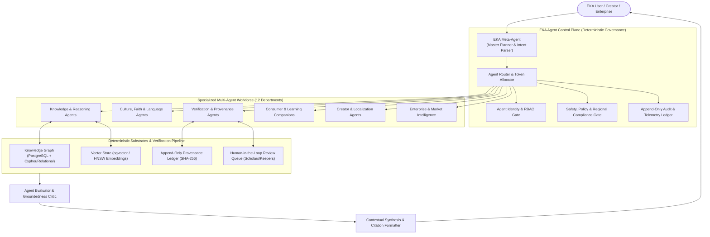
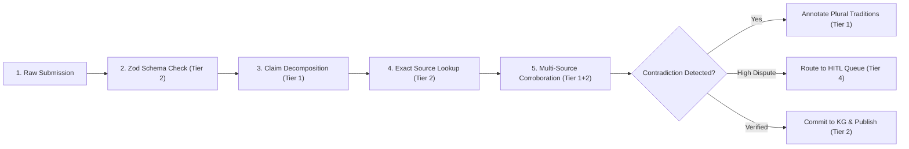
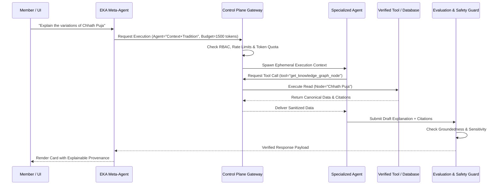
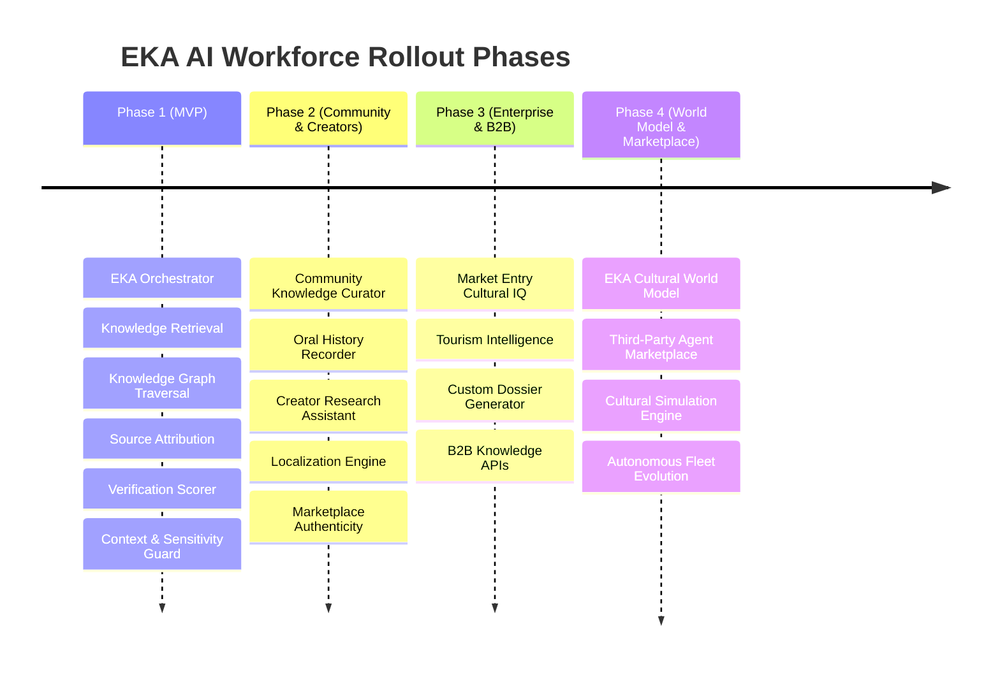

# EKA Blueprint 40: Agentic Cultural-Intelligence Operating System (ACO-OS) & 5-Tier Execution Matrix

**Document ID:** `BLU-040` / `40_EKA_AGENTIC_OPERATING_SYSTEM_AND_CAPABILITY_MATRIX.md`  
**Version:** 1.0  
**Status:** APPROVED  
**Owner:** Founder / Principal AI Architect  
**Related Documents:**
- [06_KNOWLEDGE_MODEL.md](file:///c:/Users/abhij/OneDrive/Documents/EKA/EKA/docs/blueprint/06_KNOWLEDGE_MODEL.md)
- [07_KNOWLEDGE_GRAPH.md](file:///c:/Users/abhij/OneDrive/Documents/EKA/EKA/docs/blueprint/07_KNOWLEDGE_GRAPH.md)
- [08_VERIFICATION_SYSTEM.md](file:///c:/Users/abhij/OneDrive/Documents/EKA/EKA/docs/blueprint/08_VERIFICATION_SYSTEM.md)
- [29_CONTEXT_PROTOCOL.md](file:///c:/Users/abhij/OneDrive/Documents/EKA/EKA/docs/blueprint/29_CONTEXT_PROTOCOL.md)
- [34_MULTI_AGENT_TEAMWORK_ARCHITECTURE.md](file:///c:/Users/abhij/OneDrive/Documents/EKA/EKA/docs/blueprint/34_MULTI_AGENT_TEAMWORK_ARCHITECTURE.md)
- [37_AI_INTERACTIVE_INTELLIGENCE_LAYER.md](file:///c:/Users/abhij/OneDrive/Documents/EKA/EKA/docs/blueprint/37_AI_INTERACTIVE_INTELLIGENCE_LAYER.md)
- [docs/02-trust/AI_GOVERNANCE.md](file:///c:/Users/abhij/OneDrive/Documents/EKA/EKA/docs/02-trust/AI_GOVERNANCE.md)

---

## 1. Executive Summary & Paradigm Shift

EKA is not a "social network with a chatbot," nor is it a disorganized constellation of 100 autonomous bots. EKA is an **Agentic Cultural-Intelligence Operating System (ACO-OS)**.

In sacred traditions, regional customs, historical timelines, and living communal heritage, **uncontrolled non-deterministic AI generation is an existential risk**. Hallucinating a Vedic verse, declaring a regional folklore variant "wrong," or collapsing a nuanced theological disagreement into a single synthetic answer destroys platform trust.

Therefore, EKA's agentic architecture separates:
1. **Agent Runtime:** Isolated execution contexts with strict token budgets and memory boundaries.
2. **Knowledge Substrate:** Graph-based canonical facts, primary citations, and provenance chains (`docs/blueprint/07_KNOWLEDGE_GRAPH.md`).
3. **Deterministic Control Plane:** Centralized identity, policy enforcement, rate limiting, and auditable tool gateways.
4. **Governance & Human Escalation:** Strict boundaries determining what an LLM can infer versus what requires human custodianship.



---

## 2. The 5-Tier Execution Classification Matrix

To prevent an unaffordable, unmanageable "100-agent spaghetti architecture," every capability proposed across EKA is rigorously mapped into one of five execution tiers.

```mermaid
quadrantChart
    title EKA Capability Execution Matrix
    x-axis Low Autonomy / Strict Determinism --> High Autonomous Reasoning
    y-axis Operational / Algorithmic --> Deep Cultural / Sacred Sensitivity
    quadrant-1 Tier 1: Autonomous LLM Agents
    quadrant-2 Tier 4: Human-in-the-Loop (HITL)
    quadrant-3 Tier 2: Deterministic Services
    quadrant-4 Tier 3: Orchestrated Workflows
```

### 2.1 Tier 1: Autonomous LLM Agents (Semantic & Probabilistic Reasoning)
*When to use:* High-ambiguity tasks requiring semantic understanding, linguistic translation preserving cultural connotations, fuzzy intent extraction, multi-perspective debate, or personalized conversational pedagogy.
*Characteristics:* Probabilistic, bounded by strict prompt contracts, scoped to ephemeral runtimes, subject to post-hoc verification.

| Capability | Role & Operational Boundary | Typical Model Class |
| :--- | :--- | :--- |
| **EKA Meta-Agent** | Deconstructs user queries into dependency DAGs and orchestrates agents. | Frontier Reasoning (e.g. Gemini 1.5 Pro / Ultra) |
| **Reasoning & Analogy Agent** | Compares traditions across regions (e.g. Baisakhi vs. Vishu vs. Bohag Bihu) without collapsing nuances. | Frontier Reasoning |
| **Cultural Translation Agent** | Preserves idiomatic and spiritual meaning rather than literal phonetic substitution. | High-capacity Multilingual LLM |
| **Claim Decomposition Agent** | Splits statements into: (1) Verifiable ritual existence, (2) Lived cultural belief, (3) Empirical assertion. | Frontier Fast LLM (Flash) |
| **Agent Critic & Debate** | Challenges claims and unearths counter-sources before public rendering. | Frontier Reasoning |
| **Creator Writing Assistant** | Assists creators in drafting scripts and synthesizing research dossiers from citations. | Frontier Fast LLM (Flash) |
| **Learning Companion** | Adapts explanations, tone, and reading level for students, seekers, and researchers. | Frontier Fast LLM (Flash) |

### 2.2 Tier 2: Deterministic Microservices & Algorithms (Exact & Non-Probabilistic)
*When to use:* Mathematical calculations, exact matches, graph traversals, cryptographic hashing, access control, database writes, and billing operations.
*Rule:* **Never delegate math, authorization, or primary citation lookups to probabilistic LLMs.**

| Capability | Implementation Engine | SLA / Precision Guarantee |
| :--- | :--- | :--- |
| **Entity Resolution & Deduplication** | Levenshtein distance, MinHash LSH, and normalized soundex algorithms in PostgreSQL. | 100% Deterministic |
| **Knowledge Graph Traversal** | Recursive SQL CTEs / Graph queries traversing `Tradition ↔ Region ↔ Community ↔ Ritual ↔ Place`. | Sub-5ms Indexed Lookup |
| **Semantic Vector Retrieval** | `pgvector` HNSW index with cosine similarity filtering. | Pure vector math |
| **Provenance Hashing** | SHA-256 Merkle trees recording exact document change history and source URLs. | Cryptographically immutable |
| **Token & Cost Accounting** | Internal ledger logging exact input/output tokens per session against account limits. | Exact currency/token math |
| **RBAC & Authorization** | Supabase Row-Level Security (RLS) policies and JWT validation. | Hard kernel boundary |
| **Schema Validation** | Zod schemas and TypeScript type guards for all agent inputs and tool outputs. | Strict binary validation |

### 2.3 Tier 3: Deterministic Orchestrated Workflows (DAGs / State Machines)
*When to use:* Multi-step business processes where the sequence of operations must be reliable, auditable, and idempotent, even if individual steps invoke Tier 1 agents.
*Implementation:* In-process durable state machines or Temporal/Cadence-style workflows.



| Workflow | Sequence & Stages | Fallback / Failure Mode |
| :--- | :--- | :--- |
| **Content Ingestion & Card Generation** | Web/Book Crawl → OCR/Parse → Entity Extract → Attribution → Dedup → Graph Node Link. | Rollback transaction if source verification fails. |
| **Explainable Provenance Pipeline** | Claim submission → Zod check → Fact vs Belief split → Canonical lookup → Verification scoring → UI badge. | Default to `Level 0: Unverified Contribution`. |
| **Creator Payout Settlement** | Append-only ledger close → Commission subtraction → Fraud check → Stripe/Razorpay payout. | Halt and notify finance if ledger imbalance $> 0.00$. |
| **Security Incident Circuit Breaker** | Prompt injection spike detected → Throttle agent IP → Revoke session token → Alert security. | Hard kill-switch; fallback to static cached answers. |

### 2.4 Tier 4: Human-in-the-Loop (HITL) Gateways
*When to use:* High-stakes decisions involving religious sentiments, contested regional identities, legal compliance, or irreversible administrative actions.
*Principle:* AI recommends; authorized humans decide.

| Decision Domain | Human Authority | Trigger Condition |
| :--- | :--- | :--- |
| **Theological & Lineage Arbitration** | Accredited Lineage Scholars & Councils | Disputed canonical interpretations or conflicting sectarian claims. |
| **Living Tradition Stewardship** | Native Community Keepers & Elders | Oral history discrepancies or claims about living sacred rites. |
| **Hate Speech & Defamation Appeals** | Human Trust & Safety Officers | Edge-case boundary disputes between cultural critique and targeted hate. |
| **Merchant & Practitioner Accreditations** | EKA Operations Staff | Verification of physical credentials, licenses, or spiritual lineage claims. |
| **Legal Subpoenas & Takedown Demands** | Legal Counsel | Copyright DMCA notices, court orders, or statutory takedown requests. |

### 2.5 Tier 5: Never-Automated Sacred & Ethical Boundaries
*When to use:* Never. These operations are strictly forbidden from automation to protect spiritual sanctity, human dignity, and the integrity of EKA's mission.

> [!CAUTION]
> ### EKA's Absolute Red Lines (Never to be Automated)
> 1. **No Automated Decrees of Spiritual Authenticity:** An AI shall never issue a declaration that one religious doctrine is "true" or that another is "heretical."
> 2. **No Automated Erasure of Oral Traditions:** Living traditions lacking western-style academic citations shall never be automatically pruned or marked as "false" by an algorithmic crawler.
> 3. **No Automated Substitution for Lived Practice:** EKA agents shall never claim to replace sacred darshan, personal ritual performance, genuine pilgrimage, or living guru-disciple relationships.
> 4. **No Automated Guarantee of Supernatural Outcomes:** Claims guaranteeing wealth, health, or progeny through rituals must be blocked from receiving verified trust badges.
> 5. **No Autonomous Financial Seizures:** Creator funds or practitioner escrow balances shall never be permanently confiscated without multi-person human sign-off.

---

## 3. The 12 Agent Departments: Taxonomy & Execution Mapping

| Department | Purpose | Sample Capabilities | Execution Tier Distribution |
| :--- | :--- | :--- | :--- |
| **01. Intelligence Core** | Central reasoning & contextual foundation | Meta-Agent, Reasoner, Semantic Search, Cross-Language | 70% Tier 1, 30% Tier 2 |
| **02. Cultural Knowledge** | Structuring cultural memory & living practice | Extraction, Lineage, Diaspora, Living Tradition, Endangered | 50% Tier 1, 40% Tier 2, 10% Tier 4 |
| **03. Verification & Truth** | Generating Explainable Provenance | Claim Decomposition, Corroborator, Contradiction, Evidence Scorer | 30% Tier 1, 40% Tier 2, 30% Tier 3/4 |
| **04. Trust, Safety & Gov** | Protecting community safety & ethical bounds | Sensitivity, Anti-Harassment, Synthetic Media, Policy Guard | 40% Tier 1, 40% Tier 2, 20% Tier 4 |
| **05. Places & Geography** | Sacred geography, pilgrimage & local life | Sacred Place, Temple Guide, Itinerary, Regional Variations | 60% Tier 1, 40% Tier 2 |
| **06. Arts, Food & Heritage** | Tangible culture, culinary history, crafts | Recipe Heritage, Craft Linage, Music Tradition, Architecture | 70% Tier 1, 30% Tier 2 |
| **07. People & Community** | Lineage preservation, family memories, oral history | Oral History Recorder, Community Rep, Family Archive | 30% Tier 1, 20% Tier 2, 50% Tier 4/5 |
| **08. Creator Economy** | Assisting cultural custodians & creators | Research Assistant, Localization, Structuring, Growth | 80% Tier 1, 20% Tier 2 |
| **09. Education & Learning** | Accessible cultural literacy across generations | Socratic Tutor, Children's Story, Curriculum, Quizzes | 90% Tier 1, 10% Tier 2 |
| **10. Commerce & Local Econ** | Ethical local economy & artisan livelihoods | Business Verification, Artisan Match, Authenticity, Booking | 20% Tier 1, 60% Tier 2, 20% Tier 3 |
| **11. Enterprise Cultural IQ** | B2B cultural consulting & risk analysis | Market Entry IQ, Brand Sensitivity, Tourism Reports | 70% Tier 1, 30% Tier 2 |
| **12. Agent Control & Fleet** | Operating, evaluating, and securing the fleet | Agent Registry, Token Budget, Drift Monitor, Circuit Breaker | 10% Tier 1, 80% Tier 2, 10% Tier 3 |

---

## 4. EKA Agent Control Plane Specification

No agent executes in isolation. All invocations pass through the **EKA Control Plane**:



### 4.1 Agent Manifest Schema

Every agent in EKA must be formally registered with this contract:

```ts
// src/lib/agents/types.ts
export interface EkaAgentManifest {
  agentId: string;
  name: string;
  department:
    | "intelligence"
    | "culture"
    | "verification"
    | "safety"
    | "geography"
    | "arts_food"
    | "community"
    | "creator"
    | "education"
    | "commerce"
    | "enterprise"
    | "fleet_ops";
  executionTier: 1 | 2 | 3 | 4;
  systemPromptHash: string;
  allowedTools: string[];
  maxTokensPerTurn: number;
  costTier: "low" | "medium" | "high";
  requiresHITLApproval: boolean;
  modelRecommendation: "gemini-1.5-flash" | "gemini-1.5-pro" | "deterministic-service";
}
```

### 4.2 Fleet Governance & Observability Invariants

1. **Distributed Tracing:** Every multi-agent call tree shares a single `trace_id`. Each agent turn logs a child `span_id` with token counts, latency, and tool invocations.
2. **Deterministic Fallback:** If an agent encounters a timeout (> 4000ms) or rate limit, the system gracefully falls back to the deterministic primary source card directly from PostgreSQL without stalling the UI.
3. **Auditor Certifications:** Changes to canonical knowledge graph nodes require a signed audit certificate from the Evidence Scoring engine before publication.

---

## 5. Phased Rollout Roadmap



### Phase 1: MVP Core (12 Active Agents & Deterministic Substrates)
*Active in current production builds (`src/lib/ai-knowledge.ts` & `/mcp`)*
1. **EKA Orchestrator (Meta-Agent):** Master intent routing.
2. **Knowledge Retrieval Engine (Tier 2/1):** Semantic + SQL lookup.
3. **Knowledge Graph Traversal (Tier 2):** Relationship discovery.
4. **Source & Lineage Attribution (Tier 2):** Canonical citation binder.
5. **Claim Decomposition Agent (Tier 1):** Fact vs. belief separation.
6. **Contradiction & Plurality Agent (Tier 1):** Multi-tradition contextualizer.
7. **Religious Sensitivity Guard (Tier 1/2):** Defamation and inflammatory language shield.
8. **Explainable Provenance Scorer (Tier 2/3):** Verification ladder calculation.
9. **Cultural Context Formatter (Tier 1):** Deepstash-style card authoring.
10. **Ask EKA Guide (Tier 1):** Conversational user interface.
11. **Founder Analytics Agent (Tier 2):** Economic ledger and platform health summaries.
12. **Agent Control Gatekeeper (Tier 2):** Token tracking and security checks.

---

## 6. Technical Stack Alignment with EKA Codebase

| EKA Subsystem | Technology | Agent Integration Point |
| :--- | :--- | :--- |
| **Frontend UI** | React 18, Vite, Tailwind CSS, Lucide | Ask EKA Modal, Deepstash-style card explorer, Interactive Graph Viewer |
| **Backend & DB** | Supabase PostgreSQL, Drizzle ORM | Canonical tables: `traditions`, `sources`, `provenance_ledger`, `agents_registry` |
| **Vector Search** | PostgreSQL with `pgvector` | HNSW indexes for cross-cultural semantic similarity queries |
| **Agent API** | `@lovable.dev/mcp-js` at `/mcp` | Tools exposed to external & internal agents with OAuth 2.1 authorization |
| **Economics Ledger** | Immutable Append-Only Ledger | Token consumption, creator revenue splits, and platform unit economics |
