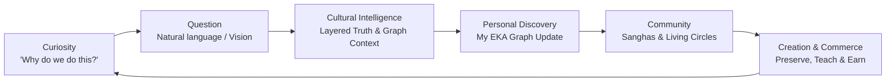
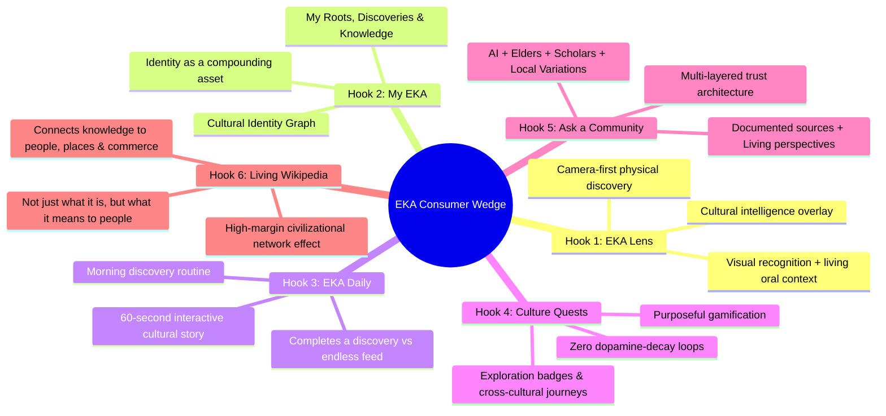
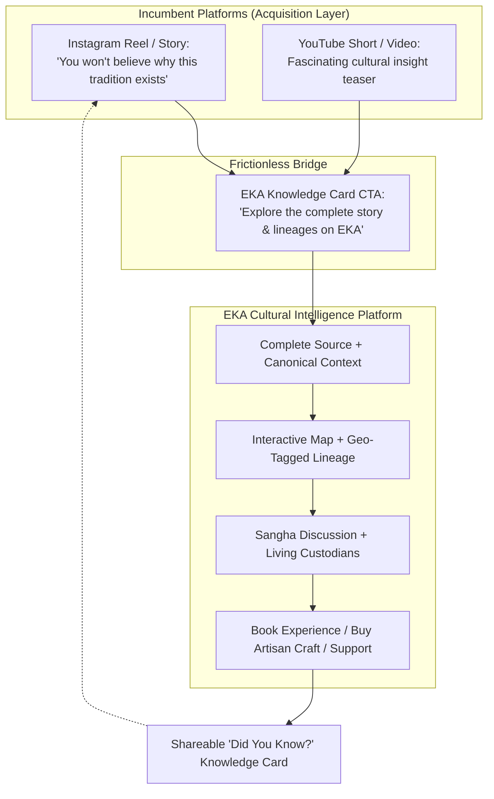
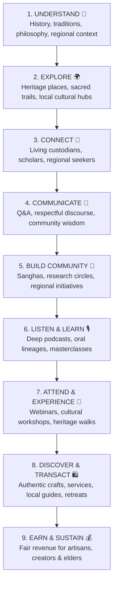
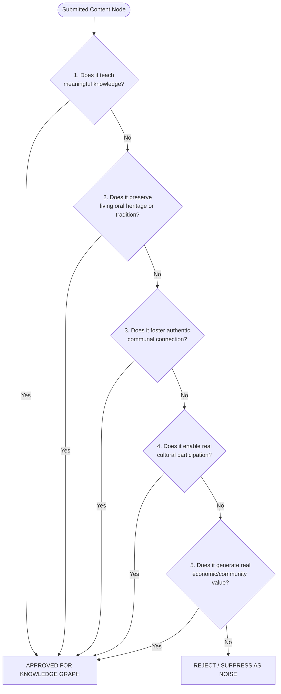

# EKA Blueprint 41: The EKA Hook — Consumer Wedge, Cultural Intelligence Layer & Anti-Noise Ecosystem

**Document ID:** `BLU-041` / `41_EKA_HOOK_CONSUMER_STRATEGY_AND_EXPERIENCE_BLUEPRINT.md`  
**Version:** 1.0  
**Status:** APPROVED  
**Owner:** Founder / Head of Product & Consumer Experience  
**Related Documents:**
- [01_VISION.md](file:///c:/Users/abhij/OneDrive/Documents/EKA/EKA/docs/blueprint/01_VISION.md)
- [06_KNOWLEDGE_MODEL.md](file:///c:/Users/abhij/OneDrive/Documents/EKA/EKA/docs/blueprint/06_KNOWLEDGE_MODEL.md)
- [07_KNOWLEDGE_GRAPH.md](file:///c:/Users/abhij/OneDrive/Documents/EKA/EKA/docs/blueprint/07_KNOWLEDGE_GRAPH.md)
- [08_VERIFICATION_SYSTEM.md](file:///c:/Users/abhij/OneDrive/Documents/EKA/EKA/docs/blueprint/08_VERIFICATION_SYSTEM.md)
- [28_HUMAN_CONTEXT_GRAPH.md](file:///c:/Users/abhij/OneDrive/Documents/EKA/EKA/docs/blueprint/28_HUMAN_CONTEXT_GRAPH.md)
- [32_ZERO_CAC_1000_USERS_PLAYBOOK.md](file:///c:/Users/abhij/OneDrive/Documents/EKA/EKA/docs/blueprint/32_ZERO_CAC_1000_USERS_PLAYBOOK.md)
- [35_CREATOR_ECONOMY_AND_PAYOUT_ENGINE.md](file:///c:/Users/abhij/OneDrive/Documents/EKA/EKA/docs/blueprint/35_CREATOR_ECONOMY_AND_PAYOUT_ENGINE.md)
- [40_EKA_AGENTIC_OPERATING_SYSTEM_AND_CAPABILITY_MATRIX.md](file:///c:/Users/abhij/OneDrive/Documents/EKA/EKA/docs/blueprint/40_EKA_AGENTIC_OPERATING_SYSTEM_AND_CAPABILITY_MATRIX.md)

---

## 1. The Strategic Dilemma & The Wedge

### 1.1 The Incumbent Attention Trap
The modern consumer landscape is saturated with platforms that dominate attention, creator incentives, personal identity, and social graphs:

| Platform | Primary Consumer Trigger | Core Optimization Metric | Psychological Moat |
| :--- | :--- | :--- | :--- |
| **Instagram** | *"What are people posting?"* | Attention / Short-term watch time | Visual vanity & social comparison |
| **YouTube** | *"What should I watch?"* | Content duration & view retention | Entertainment & passive video consumption |
| **Snapchat** | *"What are my friends doing?"* | Fleeting daily ephemeral interactions | Peer intimacy & streak pressure |
| **Facebook** | *"What is happening in my network?"* | Social graph updates & reaction loops | Network inertia & legacy connections |
| **TikTok** | *"Here’s what’s trending right now."* | Algorithmic dopamine & meme cycling | Infinite scroll addiction |

**The Fatal Error:** If EKA attempts to be *"another social network, but for culture"*, it will fail. Competing for the exact same feed behavior against multi-billion dollar recommendation engines that optimize for dopamine and vanity is a structural trap.

### 1.2 The Strategic Wedge: "Ask Your Culture"
EKA wins by targeting what incumbent platforms are **structurally incapable of fulfilling**: deep context, provenance, cultural identity as an asset, verified communal lineage, and living meaning.

$$\boxed{\text{EKA Core Question: }\mathbf{\text{“What can I discover about the world I belong to?”}}}$$

The foundational consumer loop is not a scroll loop; it is a **Discovery & Meaning Loop**:

$$\text{Curiosity} \longrightarrow \text{Question} \longrightarrow \text{Cultural Intelligence} \longrightarrow \text{Personal Discovery} \longrightarrow \text{Community} \longrightarrow \text{Creation}$$



---

## 2. The 6 Core Product Hooks



### Hook 1: EKA Lens (The Camera-First Cultural Overlay)
A user points their mobile camera at an architectural relief, sacred icon, tribal textile pattern, festive ritual utensil, or monument.
- **Physical Reality:** User sees a stone carving in a temple corridor.
- **EKA Lens Response:**
  - **Entity Identification:** *Nandi (Sacred Bull).*
  - **Tradition & Lineage:** *Shaivism · South Indian Dravidian Architecture (Chola Era, 11th c.).*
  - **Philosophical Meaning:** *Nandi represents continuous alert contemplation, patience, and attentive listening.*
  - **Living Protocol:** *Visitors traditionally approach the shrine reverently without obstructing the direct sightline between Nandi and the Sanctum Sanctorum.*
  - **Interactive Explores:** Temple Architectural History $\cdot$ Shaiva Philosophy $\cdot$ Local Oral Traditions $\cdot$ Elder Audio Snippets $\cdot$ Nearby Living Artisans.
- **Defensibility:** EKA is not competing for feed time; it becomes the **cultural intelligence layer over physical reality**.

### Hook 2: My EKA (The Personal Cultural Identity Graph)
Unlike Instagram's ephemeral grid of aesthetic highlights, **My EKA** is a personal, compounding cultural asset:
- **My Roots:** Ancestral geography, birthplace, regional dialects, ancestral villages, traditional practices.
- **My Discoveries:** Temples explored, crafts understood, regional festivals experienced, sacred journeys logged.
- **My Knowledge:** Curated authentic collections, documented familial recipes, sacred chants, preserved oral lineages.
- **My Journey:** Expanding civilizational trajectory (*e.g., Kamakhya / Assam $\rightarrow$ Bengal $\rightarrow$ Pan-India $\rightarrow$ Southeast Asia $\rightarrow$ World*).
- **Core Value:** Your cultural heritage and personal spiritual journey become an organized, generational asset.

### Hook 3: EKA Daily (The Morning Discovery Routine)
A non-addictive, intentional morning ritual that starts the day with grounded perspective:
- **Daily Drop:** *"Today, discover something that connects you to the world."* (e.g., A 900-year-old water harvesting ritual in Kerala).
- **Format:** 60-second interactive editorial story.
  1. *Screen 1:* What is this tradition?
  2. *Screen 2:* Why was it instituted? (Historical & ecological context)
  3. *Screen 3:* Where is it practiced today? (Interactive map)
  4. *Screen 4:* Lived perspective (Audio snippet from a practicing custodian)
  5. *Screen 5:* Community connection (Join the discussion or local group)
- **Outcome:** The user does not consume random content; **they complete a discrete discovery**.

### Hook 4: Culture Quests (Addictive Meaning Without Dopamine Traps)
Gamified, healthy curiosity that promotes cross-cultural empathy:
- **Quest Example:** *“Discover 5 Living Traditions from Northeast India”*
  - $\square$ 1 Sacred Sanctuary / Heritage Site
  - $\square$ 1 Traditional Weaving / Craft Lineage
  - $\square$ 1 Ancestral Food System
  - $\square$ 1 Seasonal Festival / Rhythm
  - $\square$ 1 Community Elder Story
- **Completion Milestone:** *Northeast India Cultural Explorer Distinction* (recorded in My EKA identity graph).
- **Progression:** Prompts exploration into cultures outside one's own heritage, fulfilling EKA's mission of cross-cultural resonance.

### Hook 5: Ask a Community (Layered Multi-Dimensional Truth)
Traditional search engines hallucinate or summarize generic SEO blog spam. Generic social platforms devolve into flame wars. EKA structures inquiry into 6 distinct epistemological tiers:

| Tier | Epistemological Layer | Source / Grounding | Purpose |
| :---: | :--- | :--- | :--- |
| **L1** | **Documented Sources** | Canonical texts, archaeological records, peer-reviewed archives | Historical baseline |
| **L2** | **Community Perspectives** | Living custodians, diaspora practitioners, local residents | Lived reality |
| **L3** | **Expert Interpretation** | Certified scholars, cultural historians, lineage gurus | Doctrinal nuance |
| **L4** | **AI Structured Synthesis** | Grounded KG queries with verified source citations | Instant clarity |
| **L5** | **Regional Variations** | Geographic branch comparisons (e.g., Bengal vs Tamil vs Assamese rites) | Pluralism |
| **L6** | **Interpretation vs Fact** | Explicit taxonomy separating scripture, custom, and recent innovation | Disinformation shield |

### Hook 6: Living Wikipedia (The Civilizational Network Graph)
Wikipedia explains *what something is*; EKA explains *what it means to the living people who practice it*.
- Seamlessly connects:
  $$\text{Knowledge} \longrightarrow \text{People} \longrightarrow \text{Places} \longrightarrow \text{Practices} \longrightarrow \text{Events} \longrightarrow \text{Creators} \longrightarrow \text{Businesses} \longrightarrow \text{Communities}$$
- Unlocks the transition from a content repository to a $100B network effect of cultural intelligence, commerce, and civilizational utility.

---

## 3. Product Architecture & The Homepage Paradigm

### 3.1 What EKA Home is NOT
> [!CAUTION]
> **Anti-Pattern Warning:** Do not make the EKA Home a standard feed of `Posts → Likes → Comments`. That is simply *"Instagram wearing ethnic clothing"*, which triggers immediate platform death against established incumbents.

### 3.2 The EKA Home Blueprint
```
+-----------------------------------------------------------------------------------+
|  [ EKA LOGO ]      "Don't just scroll the world. Understand it."      [ MY EKA ]   |
+-----------------------------------------------------------------------------------+
|                                                                                   |
|    🔍 WHAT ARE YOU CURIOUS ABOUT TODAY?                                           |
|    [ Search or ask anything about traditions, sacred places, philosophy, customs ]|
|                                                                                   |
+-----------------------------------------------------------------------------------+
|  ✨ TODAY IN EKA  (Daily Discovery Capsule)                                       |
|  +-----------------------------------------------------------------------------+  |
|  | [Hero Media] "The Sacred Living Bridges of Meghalaya"                       |  |
|  | 60-Second Story · Why it exists · Who maintains it · How to visit           |  |
|  +-----------------------------------------------------------------------------+  |
+-----------------------------------------------------------------------------------+
|  🧭 EXPLORE CULTURAL CLUSTERS                                                     |
|  [ North India ] [ South India ] [ East & Bengal ] [ West ] [ Northeast ] [ World ]|
+-----------------------------------------------------------------------------------+
|  👥 LIVING COMMUNITIES (Follow Living Knowledge, Not Just Personas)               |
|  [ Vedic Chanting Sangha ] [ Assam Weaving Guild ] [ Classical Odissi Circle ]    |
+-----------------------------------------------------------------------------------+
|  🎥 DOCUMENTARIANS & CUSTODIANS (People who preserve, teach & experience)         |
|  [ Prof. S. Ramanathan: Epigraphy ] [ Ananya Roy: Kalighat Art Historian ]        |
+-----------------------------------------------------------------------------------+
```

---

## 4. The Distribution & Acquisition Engine: "Instagram as Top of Funnel"

We do not wage an impossible frontal war to make users delete Instagram or YouTube immediately. Instead, **incumbent platforms become our zero-CAC acquisition layer**.



### The Viral Knowledge Card
Content shared out of EKA must never be a generic *"Follow me on EKA"*. It is an irresistible, shareable knowledge node:
> **"Did you know? In Majuli (Assam), monks create sacred masks that speak without vocal cords. Why? $\rightarrow$ Explore the living lineage on EKA."**

---

## 5. The 8-Layer Unified Ecosystem: Understand to Earn

EKA's value proposition is encapsulated in one integrated journey:
$$\mathbf{\text{UNDERSTAND}} \longrightarrow \mathbf{\text{CONNECT}} \longrightarrow \mathbf{\text{COMMUNICATE}} \longrightarrow \mathbf{\text{BUILD}} \longrightarrow \mathbf{\text{EARN}}$$

Rather than isolating these functions into disjointed tabs, EKA weaves them into a single contextual fabric:



### 5.1 Real-World Contextual Walkthrough: "Diwali Traditions in Bengal"
When a user explores this topic on EKA, they do not get a flat algorithmic feed. They receive an orchestrated, multi-dimensional experience:
1. **Learn (Understand):** The deep canonical history of Kali Puja overlapping with Diwali in Bengal.
2. **Listen (Podcasts):** An audio interview with a traditional potter in Kumartuli explaining sacred clay sculpting.
3. **Watch (Documentary):** High-definition visual documentation of nighttime temple rituals in Tarapith.
4. **Discuss (Communicate):** A moderated community forum on regional variations between rural and urban observances.
5. **Join (Community):** Entry into the Bengal Heritage Sangha.
6. **Attend (Live Event):** RSVP for an upcoming live webinar on Shakta philosophy.
7. **Experience (Tourism):** A guided heritage walk booking through ancient North Kolkata neighborhoods during the festival.
8. **Shop (Marketplace):** Verified procurement of authentic hand-cast brass lamps directly from a rural artisan collective.
9. **Learn Directly (Services):** 1-on-1 virtual workshop on traditional Bengali alpana (sacred floor art).
10. **Preserve (Creation):** User logs their own family's 4-generation domestic tradition into their private/public My EKA graph.
11. **Earn (Creator Economy):** The artisan, researcher, tour guide, and educator all receive direct economic remuneration.

---

## 6. The EKA Marketplace Architecture

The EKA marketplace is not a dropshipping e-commerce catalog; it is an **authentic cultural exchange and service ecosystem**:

```mermaid
graph TD
    Marketplace[EKA Cultural Marketplace]
    
    Marketplace --> Products[Tangible Heritage Products]
    Marketplace --> Services[Cultural & Educational Services]
    Marketplace --> Experiences[Living Experiences & Immersions]
    Marketplace --> Knowledge[Knowledge & Masterclasses]
    Marketplace --> Media[Curated & Premium Media]

    Products --> P1[Handicrafts & GI-Tagged Goods]
    Products --> P2[Sacred Ritual Utensils & Statuary]
    Products --> P3[Traditional Textiles & Weaves]
    Products --> P4[Curated Books & Rare Prints]

    Services --> S1[Lineage Educators & Language Mentors]
    Services --> S2[Spiritual Guides & Philosophy Teachers]
    Services --> S3[Heritage Photographers & Genealogists]
    Services --> S4[Cultural Tourism Guides & Curators]

    Experiences --> E1[Sacred Temple Walks & Historic Trails]
    Experiences --> E2[Artisan Apprentice Workshops]
    Experiences --> E3[Culinary Heritage Immersions]
    Experiences --> E4[Meditation & Philosophical Retreats]

    Knowledge --> K1[Structured Courses & Certifications]
    Knowledge --> K2[Closed Masterclass Sanghas]
    Knowledge --> K3[Direct Scholar Consultations]

    Media --> M1[Graph-Linked Audio Podcasts]
    Media --> M2[Interactive Live Webinars & AMAs]
    Media --> M3[Cultural Documentaries & Recordings]
```



---

## 7. The Strict Anti-Noise Policy & Content Principles

### 7.1 Explicit Content Blacklist (The "Anti-Brainrot" Boundary)
EKA strictly eliminates dopamine-farming, vanity-seeking, and zero-substance media:

$$\mathbf{\text{EKA Core Rule: }}\text{No content for attention alone. Every piece must create understanding, connection, or value.}$$

```
❌ ZERO TOLERANCE FOR:
- "Get Ready With Me" (GRWM) / Fast-fashion hauls
- Narcissistic vanity posts / Generic selfies / Gym flexing
- Influencer lifestyle bragging / Aesthetic flexes
- Rage-baiting / Partisan political outrage / Flame wars
- Recycled internet memes / Reaction videos without insight
- Generic empty motivational aphorisms
- Algorithmic watch-time traps (ASMR triggers without cultural context)
- Scraping bots / AI-generated SEO content farms
```

### 7.2 The 5-Question Content Filter
Every community post, media submission, or creator story must satisfy at least one primary directive of the **EKA Content Filter**:



### 7.3 Algorithmic Incentive Restructuring
Incumbent algorithms optimize for **Dopamine $\times$ Controversy $\times$ Watch Time**. EKA optimizes for **Epistemic Depth $\times$ Trust $\times$ Value**:

| Metric | Incumbent Platforms (Meta / ByteDance) | EKA Platform Standard |
| :--- | :--- | :--- |
| **Primary Currency** | Views, Retweets, Sensationalist Likes | Saves, Annotations, Verified Citations |
| **User Incentive** | Chasing viral view counts | Earning community trust & peer respect |
| **Creator Reward** | Ad impressions & vanity sponsorships | Workshop bookings, paid sanghas, direct patronage |
| **Platform Tone** | High anxiety, FOMO, cognitive fragmentation | Grounded contemplation, reverence, deep discovery |

---

## 8. Summary of Platform Brand Positioning

| Platform | Consumer Invitation | User State Upon Leaving |
| :--- | :--- | :--- |
| **Instagram** | *"Look at me."* | Anxious, distracted, socially compared |
| **YouTube** | *"Watch this next."* | Time-drained, passively entertained |
| **TikTok** | *"Here is what is trending."* | Dopamine-depleted, attention-shortened |
| **Snapchat** | *"Look what we did."* | Ephemeral peer validation |
| **EKA** | **“Come understand this.”** | **Enriched, grounded, connected, inspired** |

---

## 9. Implementation Roadmap & Milestones

1. **P0 (Immediate Product Refinement):**
   - Implement the **"Ask Your Culture"** interactive search hero as the primary Home viewport.
   - Refactor Home discovery cards to represent discrete knowledge nodes (Festival, Tradition, Community, Craft).
   - Enforce the 5-Question Content Filter in community submission guidelines and moderation prompts.
2. **P1 (Core Feature Deployment):**
   - Launch **EKA Daily**: 60-second interactive discovery capsules with swipe-based learning.
   - Launch **My EKA**: Personal cultural identity graph (My Roots, Discoveries, Knowledge).
   - Launch **Culture Quests**: First regional exploration track (Northeast India & South Indian Heritage).
3. **P2 (Ecosystem & Marketplace Integration):**
   - Launch **EKA Lens** beta (Visual recognition tied to Knowledge Graph nodes).
   - Connect **Podcasts & Webinars** directly to interactive knowledge graph entity cards.
   - Wire unified **Service & Experience Marketplace** into knowledge search queries.
