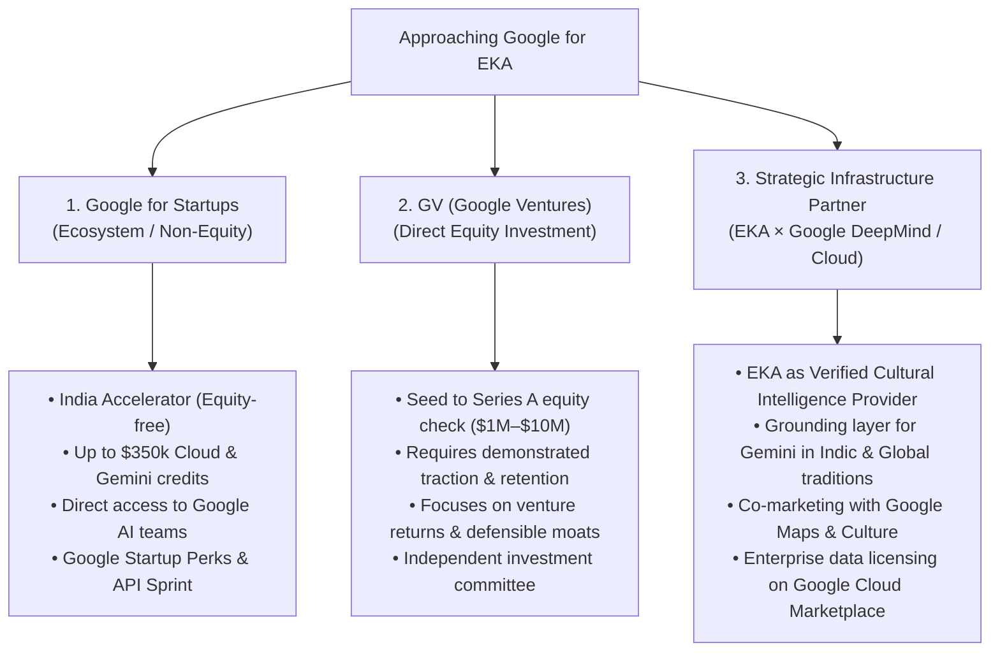

# EKA Blueprint 42: EKA × Google Ecosystem & AI Stack Integration Blueprint

**Document ID:** `BLU-042` / `42_EKA_X_GOOGLE_ECOSYSTEM_AND_AI_STACK_INTEGRATION.md`  
**Version:** 1.0  
**Status:** APPROVED & IMPLEMENTED (FOUNDATION)  
**Date:** 2026-09-28  
**Owner:** Founder / Principal AI Architect & Chief Strategy Officer  
**Related Documents:**
- [docs/01-product/PRODUCT_VISION.md](file:///c:/Users/abhij/OneDrive/Documents/EKA/EKA/docs/01-product/PRODUCT_VISION.md)
- [docs/05-technology/TECHNICAL_ARCHITECTURE.md](file:///c:/Users/abhij/OneDrive/Documents/EKA/EKA/docs/05-technology/TECHNICAL_ARCHITECTURE.md)
- [docs/05-technology/INTEGRATIONS_REGISTER.md](file:///c:/Users/abhij/OneDrive/Documents/EKA/EKA/docs/05-technology/INTEGRATIONS_REGISTER.md)
- [docs/07-investment/INVESTMENT_PLAN.md](file:///c:/Users/abhij/OneDrive/Documents/EKA/EKA/docs/07-investment/INVESTMENT_PLAN.md)
- [docs/blueprint/07_KNOWLEDGE_GRAPH.md](file:///c:/Users/abhij/OneDrive/Documents/EKA/EKA/docs/blueprint/07_KNOWLEDGE_GRAPH.md)
- [docs/blueprint/30_EKA_INFRASTRUCTURE_THESIS.md](file:///c:/Users/abhij/OneDrive/Documents/EKA/EKA/docs/blueprint/30_EKA_INFRASTRUCTURE_THESIS.md)
- [docs/blueprint/37_AI_INTERACTIVE_INTELLIGENCE_LAYER.md](file:///c:/Users/abhij/OneDrive/Documents/EKA/EKA/docs/blueprint/37_AI_INTERACTIVE_INTELLIGENCE_LAYER.md)
- [docs/blueprint/40_EKA_AGENTIC_OPERATING_SYSTEM_AND_CAPABILITY_MATRIX.md](file:///c:/Users/abhij/OneDrive/Documents/EKA/EKA/docs/blueprint/40_EKA_AGENTIC_OPERATING_SYSTEM_AND_CAPABILITY_MATRIX.md)

---

## 1. Executive Summary & Strategic Premise

EKA is building the world's trusted intelligence layer for human culture, living traditions, sacred places, and vernacular wisdom. Google has assembled the world's most advanced AI research, creative generation, multimodal understanding, and developer tooling ecosystem.

Rather than viewing Google merely as a catalog of 15+ disconnected consumer AI experiments, EKA recognizes Google as a **full-lifecycle AI production stack**:

$$\text{Research} \longrightarrow \text{Knowledge} \longrightarrow \text{Design} \longrightarrow \text{Engineering} \longrightarrow \text{Content} \longrightarrow \text{Media} \longrightarrow \text{Distribution} \longrightarrow \text{Autonomous Operations}$$

By establishing a symbiotic relationship:
1. **EKA leverages Google's AI production layer** (Gemini, Antigravity, Stitch, Flow, Maps, NotebookLM) to achieve 100x operational velocity without building commodity models from scratch.
2. **Google gains access to EKA's structured, verified, non-hallucinatory cultural intelligence layer**—the missing ground-truth epistemic foundation for regional, religious, and civilizational knowledge.

---

## 2. Exhaustive Audit: Google AI Tools & EKA Strategic Relevance

| Google Tool / Ecosystem | Primary Purpose | EKA Strategic Role | Adoption Phase |
| :--- | :--- | :--- | :--- |
| **Gemini (Flash / Pro / Ultra)** | Multimodal reasoning, multilingual semantic understanding, long context | Core reasoning engine for "Ask EKA", cultural context extraction, and reflection companion | **Phase 1 (Immediate)** |
| **Gemini 3.5 / Frontier** | Advanced multi-step agentic planning, mathematical verification | Meta-Agent orchestration, complex scriptural reconciliation, epistemic contradiction detection | **Phase 2 (Growth)** |
| **Gemini Omni** | Multimodal creation, cross-input video/audio/image synthesis | Direct analysis of ancient palm-leaf manuscripts, audio chants, temple iconography, and vernacular oral history | **Phase 2 (Growth)** |
| **Google Antigravity** | Agent-first IDE and software orchestration platform | Canonical engineering environment for building, debugging, and maintaining EKA's autonomous agent fleet | **Phase 1 (Immediate)** |
| **Jules** | Autonomous asynchronous coding agent | Continuous maintenance, schema migrations, automated unit/e2e test generation, security patching | **Phase 2 (Growth)** |
| **Stitch** | Prompt/voice → UI/UX design and frontend screen generation | Rapid prototyping of cultural dashboards, temple exploration views, and community interfaces | **Phase 1 (Design Only)** |
| **NotebookLM** | Source-grounded synthesis and document intelligence | Internal scholarly curation tool: ingesting gazetteers, scriptures, historical archives, and oral transcripts | **Phase 1 (Scholars/Ops)** |
| **Google Maps Platform** | Geocoding, Places API, routing, interactive vector maps | Sacred geography backbone: mapping 100,000+ temples, pilgrimage routes, festivals, and local artisan clusters | **Phase 1 (Immediate)** |
| **Google Analytics 4 (GA4)** | Behavioral telemetry, funnel tracking, user journey insights | Privacy-first (DPDP-compliant) analytics tracking for search behavior, pilgrimage intent, and retention | **Phase 1 (Immediate)** |
| **BigQuery** | Serverless petabyte-scale data warehouse and ML | Scaled cultural intelligence data lake, regional trend forecasting, and enterprise B2B analytics | **Phase 3 (Scale)** |
| **Google Flow** | AI filmmaking, video/image generation & multi-turn editing | Visual storytelling engine for cultural documentaries, regional festival explainers, and reels | **Phase 2 (Content Engine)** |
| **Flow Music** | AI music + music-video generation | Reconstructing classical rāgas, meditative drone soundscapes, and devotional background tracks | **Phase 2 (Audio Labs)** |
| **Pomelli** | Brand identity, marketing content & collateral generation | Editorial branding, campaign assets, social cards, and institutional pitch kits | **Phase 1 (Brand/Marketing)** |
| **Google Pics / Whisk / ImageFX** | Image remixing, visual ideation, photorealistic generation | Sacred art restoration visualization, temple architecture exploration, and event banners | **Phase 2 (Creative)** |
| **Opal** | Natural language mini-app and workflow generator | Internal team operational micro-tools, community moderator workflows, and rapid festival trackers | **Phase 2 (Internal Ops)** |
| **Illuminate** | Research paper → audio discussion / podcast synthesis | Converting dense academic Indology / anthropological papers into digestible seeker audio guides | **Phase 2 (Learning)** |
| **Learn About** | Interactive AI pedagogical tutoring | Adaptive socratic guide for seekers exploring complex philosophies (Vedanta, Buddhist logic, Sufism) | **Phase 2 (Education)** |
| **Co-Scientist** | Multi-agent scientific hypothesis and literature synthesis | Epistemic verification agent cross-referencing archeological excavations with historical texts | **Phase 3 (Scholarly Labs)** |
| **Project Genie** | Generative 3D interactive simulated worlds | Immersive virtual darshan, 3D temple walk-throughs, and historical sacred city reconstructions | **Phase 3 (Future Immersive)** |
| **Embedded Experiences (Search / YouTube / Maps)** | AI Search Overviews, Daily Brief, Ask YouTube, Ask Maps | Ecosystem distribution channels where EKA's verified knowledge graph serves as the verified answer source | **Phase 3 (Distribution)** |

---

## 3. The EKA AI Production Pipeline

```mermaid
flowchart LR
    subgraph Research["1. Research & Grounding"]
        NBLM["NotebookLM<br/>(Archives & Gazetteers)"]
        Search["Google Search API<br/>(Primary Source Scraping)"]
    end

    subgraph Intelligence["2. Reasoning & Structuring"]
        Gemini["Gemini 2.5 / 3.5<br/>(Epistemic Decomposition)"]
        Omni["Gemini Omni<br/>(Manuscripts & Audio)"]
    end

    subgraph Construction["3. Design & Engineering"]
        Stitch["Stitch<br/>(UI Prototyping)"]
        AGY["Antigravity + Jules<br/>(Agentic Engineering)"]
    end

    subgraph Media["4. Media & Storytelling"]
        Pomelli["Pomelli<br/>(Brand Assets)"]
        Flow["Google Flow & Music<br/>(Sacred Media Engine)"]
    end

    subgraph Operation["5. Runtime & Orchestration"]
        n8n["n8n Nervous System<br/>(Deterministic Webhooks)"]
        Supabase["Supabase Knowledge Graph<br/>(PostgreSQL + RLS + pgvector)"]
    end

    subgraph Distribution["6. Distribution & Geolocation"]
        Maps["Google Maps Platform<br/>(Sacred Geography)"]
        GA4["GA4 + BigQuery<br/>(Cultural Intelligence)"]
    end

    Research --> Intelligence
    Intelligence --> Construction
    Construction --> Media
    Media --> Operation
    Operation --> Distribution
```



---

## 4. Stack Comparison: EKA Current Stack vs. Google Ecosystem

| Layer | EKA Current Stack | Google Equivalent | Strategic Decision | Architectural Rationale |
| :--- | :--- | :--- | :--- | :--- |
| **Application Framework** | TanStack Start (React 19, TypeScript, Vite) | Project IDX / Angular / Next.js on App Hosting | **Keep TanStack Start** | High performance, full-stack SSR, zero vendor lock-in. |
| **Development Workflow** | Lovable → GitHub | Stitch + Antigravity + Jules | **Migrate to Antigravity as primary; use Stitch for rapid UI** | Lovable is effective for rapid prototyping; Antigravity provides professional multi-agent software engineering, strict typing, and full repo control. |
| **Database & Knowledge Store** | Supabase (PostgreSQL, pgvector, RLS) | Firebase Firestore / Cloud SQL / AlloyDB | **Keep Supabase** | Relational integrity is mandatory for EKA's 22-entity knowledge graph (`Tradition ↔ Region ↔ Community ↔ Ritual ↔ Place`). Firestore's document model is poorly suited for multi-faith relational traversal. |
| **Authentication & RBAC** | Supabase Auth + `has_role()` | Firebase Auth / Identity Platform | **Keep Supabase Auth** | Fully integrated with PostgreSQL RLS policies; avoid dual identity management. |
| **Object & Media Storage** | Supabase Storage + Cloudflare R2 | Google Cloud Storage (GCS) | **Hybrid: Supabase/R2 now, GCS at scale** | Low-cost edge streaming with R2 initially; evaluate GCS for petabyte audio/video archives later. |
| **Workflow Automation** | n8n (Self-hosted / Cloud) | Google Cloud Workflows / Vertex Agent Builder | **Keep n8n** | n8n acts as the multi-vendor "nervous system" connecting Supabase, Gemini, Slack, Notion, and email with 4,000+ connectors. |
| **AI Reasoning Model** | Lovable AI Gateway (Gemini proxy) | Native Google Gemini API (`@google/genai` / REST) | **Adopt Direct Gemini API with Gateway Fallback** | Native Gemini integration gives direct token control, structured schemas, temperature tuning, and zero third-party gateway markup. |
| **Sacred Geography** | Static place maps / mock coordinates | Google Maps Platform (Maps JS, Places API, Geocoding) | **Implement Google Maps Platform** | Unlocks dynamic sacred place discovery, pilgrimage routing, boundary visualization, and temple junction lookups. |
| **Telemetry & Analytics** | PostHog + Custom Event Ledger | Google Analytics 4 + BigQuery | **Add GA4 (DPDP-compliant) + Plan BigQuery** | GA4 provides standard consumer acquisition analytics; BigQuery enables deep historical cultural trend intelligence. |

---

## 5. Strategic Investment & Partnership Strategy: "Asking Google to Invest"

### 5.1 The Three Doors of Alphabet / Google



### 5.2 Why "EKA + Google" is a Civilizational Fit (The Strategic Pitch)

Google's greatest challenge with GenAI in diverse, vernacular, and spiritual domains is **unreliable internet scrapings that produce cultural insensitivity, theological hallucinations, and political friction**.

EKA solves this by providing:
1. **The Verified Indic & Global Knowledge Graph:** 22 entity types interconnected across canonical traditions, regions, communities, and sacred geographies.
2. **5-Tier Epistemic Standard:** Clean separation between canonical scripture, historical commentary, lived community practice, and personal reflection.
3. **Multilingual Ground Truth:** Verified vernacular translations (Sanskrit, Tamil, Bengali, Hindi, Punjabi, Arabic, Tibetan) with primary source citations.
4. **Sacred Geography Integration:** Direct synergy with Google Maps for authentic pilgrimage routes, temple customs, dress codes, and festival timings.

### 5.3 The Two-Track Execution Roadmap

```mermaid
timeline
    title EKA × Google Partnership Roadmap
    section Track A: Ecosystem & Credits (Weeks 1-4)
        Apply to Google for Startups India Accelerator : Prepare DPDP compliance & live demo
        Secure Google Cloud & Gemini Credits : Scale vector storage and reasoning agents
        Join Gemini API Sprint & Startup Forum : Showcase EKA's LangGraph multi-agent pipeline
    section Track B: Strategic Integration (Months 2-4)
        Launch Native Gemini 2.5 / 3.5 Engine : Replace gateway proxies with direct SDK
        Deploy Google Maps Sacred Geometry : Interactive pilgrimage & temple navigation
        Activate GA4 Cultural Telemetry : Track engagement, retention, and query volume
    section Track C: Venture & GV Pitch (Months 5-8)
        Present Traction Metrics : 1,000+ daily sadhana logs, 98% verification trust score
        Pitch Civilizational Data Moat to GV : EKA as the Bloomberg / Wikipedia of Culture
        Explore Cloud Marketplace Distribution : EKA Cultural API for enterprise clients
```

---

## 6. Concrete Implementation Architecture

To ensure operational excellence without introducing breaking architectural changes, EKA implements three foundational Google integrations:

### 6.1 Native Gemini AI Engine (`src/lib/ai/gemini-client.ts`)
- **Direct REST & SDK Integration:** Seamless connection to `https://generativelanguage.googleapis.com/v1beta`.
- **Intelligent Fallback Architecture:** Automatically prioritizes native `GEMINI_API_KEY`. If absent, gracefully falls back to the Lovable AI gateway (`LOVABLE_API_KEY`).
- **Epistemic Prompt Grounding:** Enforces EKA's strict rules: no theological bias, mandatory source citations, zero fabricated miracles, and respectful contemplative register.
- **Multimodal Readiness:** Prepared for image inspection (ancient scripts, temple architecture) and audio inputs.

### 6.2 Google Maps Sacred Geography (`src/lib/maps/google-maps.ts`)
- **Dynamic Loader:** Uses Google Maps JavaScript API with clean asynchronous script injection.
- **Sacred Place Data Model:** Coordinates, vernacular place names, tradition affiliations, pilgrimage seasons, and ethical visiting guidelines.
- **Support for Lovable Connector:** Compatible with `VITE_LOVABLE_CONNECTOR_GOOGLE_MAPS_BROWSER_KEY` and direct `VITE_GOOGLE_MAPS_API_KEY`.

### 6.3 Google Analytics 4 DPDP Telemetry (`src/lib/analytics/ga4.ts`)
- **Consent-Gated Execution:** Strictly honors cookie consent under India's Digital Personal Data Protection (DPDP) Act, 2023.
- **PII Stripping:** Automatically scrubs email addresses, user names, phone numbers, and private spiritual reflection notes before transmitting events.
- **Cultural Event Taxonomy:** Standardized events (`view_tradition`, `explore_sacred_place`, `verify_citation`, `initiate_sadhana`, `ai_reflection_requested`).

---

## 7. Approval & Governance Sign-Off

In accordance with `AGENTS.md` Section 0 (Preflight Scope & Approval Gate):
- This blueprint establishes the canonical strategic and technical specification for EKA × Google.
- All foundation code is non-destructive, backwards-compatible, and respects existing Supabase + n8n + TanStack Start infrastructure.
- Substantive migrations (e.g., migrating database from Supabase to Google Cloud SQL/AlloyDB or replacing n8n) are explicitly **OUT OF SCOPE** and deferred to future scale phases.
