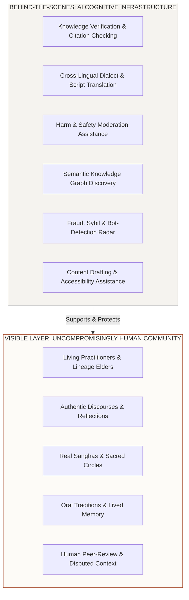
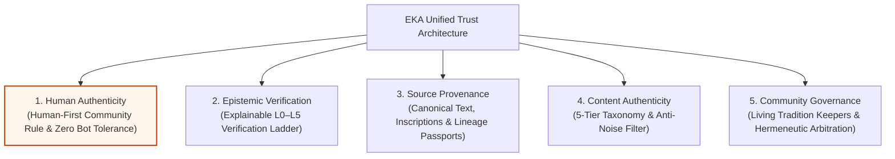
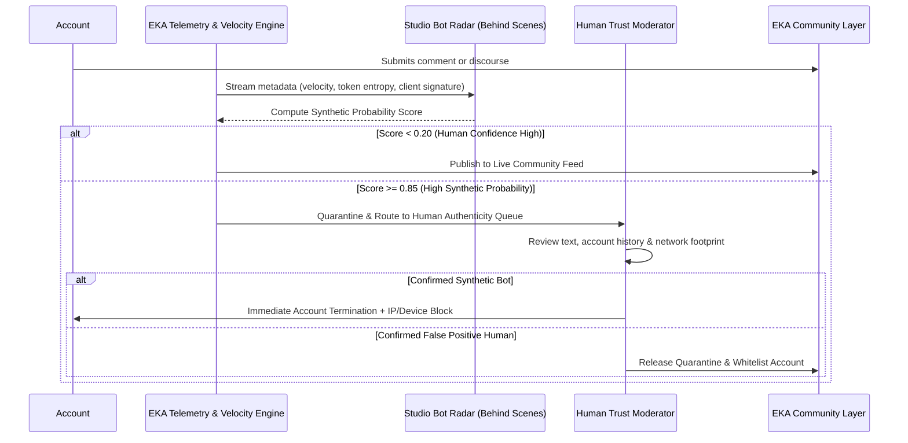

# EKA Blueprint 43: Human Authenticity & The 5-Pillar Trust Architecture

**Document ID:** `BLU-044` / `43_HUMAN_AUTHENTICITY_AND_TRUST_ARCHITECTURE.md`  
**Version:** 1.0  
**Status:** APPROVED  
**Classification:** Canonical Trust Architecture & Platform Governance  
**Strategic Horizon:** Anti-Dead-Internet Sanctuary & Civilizational Knowledge Integrity  
**Related Documents:**
- [TRUST_AND_VERIFICATION_FRAMEWORK.md](file:///c:/Users/abhij/OneDrive/Documents/EKA/EKA/docs/02-trust/TRUST_AND_VERIFICATION_FRAMEWORK.md)
- [AI_GOVERNANCE.md](file:///c:/Users/abhij/OneDrive/Documents/EKA/EKA/docs/02-trust/AI_GOVERNANCE.md)
- [01_VISION.md](file:///c:/Users/abhij/OneDrive/Documents/EKA/EKA/docs/blueprint/01_VISION.md)
- [08_VERIFICATION_SYSTEM.md](file:///c:/Users/abhij/OneDrive/Documents/EKA/EKA/docs/blueprint/08_VERIFICATION_SYSTEM.md)
- [37_AI_INTERACTIVE_INTELLIGENCE_LAYER.md](file:///c:/Users/abhij/OneDrive/Documents/EKA/EKA/docs/blueprint/37_AI_INTERACTIVE_INTELLIGENCE_LAYER.md)
- [41_EKA_HOOK_CONSUMER_STRATEGY_AND_EXPERIENCE_BLUEPRINT.md](file:///c:/Users/abhij/OneDrive/Documents/EKA/EKA/docs/blueprint/41_EKA_HOOK_CONSUMER_STRATEGY_AND_EXPERIENCE_BLUEPRINT.md)

---

## 1. Executive Thesis & Strategic Positioning

> **"The intelligence is artificial. The community isn't."**  
> **"AI-powered knowledge. Human-powered community."**

Modern consumer platforms have entered a terminal spiral termed the **"Dead Internet"**: an ecosystem overrun by automated bot swarms, autonomous LLM personas, algorithmic engagement pods, and synthetic comments designed to manipulate engagement metrics.

For a cultural, spiritual, and civilizational platform, synthetic engagement is fatal. Cultural heritage, devotional practice, ancestral lineage, and local wisdom derive their authority from **lived human reality**. A bot masquerading as a living practitioner, simulating religious grief, or generating synthetic commentary completely dismantles epistemic trust and community reverence.

**The EKA Principle:**  
AI serves as the tireless engine behind the curtain—indexing manuscripts, verifying citations, bridging dialects, filtering abuse, and powering semantic discovery. But the **visible community layer stays uncompromisingly human**.



---

## 2. The 5-Pillar EKA Trust Architecture

Trust on EKA is multi-dimensional and cannot be collapsed into an algorithmic score. EKA elevates **Human Authenticity** into a first-class foundational pillar alongside Verification, Provenance, Community Governance, and Content Authenticity:



| Pillar | Focus | What It Guarantees | Core Mechanism |
| :--- | :--- | :--- | :--- |
| **1. Human Authenticity** | **People** | Every participant in the public community is an authentic human being. Zero bot accounts, zero synthetic personas, zero manufactured engagement. | Sybil resistance, behavioral velocity analysis, mandatory human disclosure, and studio bot-takedown radar. |
| **2. Epistemic Verification** | **Claims** | Claims are not declared arbitrarily true/false; they earn explainable provenance from Level 0 (Unverified) to Level 5 (Archival Benchmark). | Multi-source citation audits, peer reviews, and verifiable primary manuscripts. |
| **3. Source Provenance** | **Origins** | Every canonical knowledge object links back to an immutable chain of custody (author, lineage, edition, digital archive URI). | Source Passports, URI archival fingerprints, and immutable edit histories. |
| **4. Content Authenticity** | **Expression** | Content is labeled by epistemic type (Documented Tradition, Interpretation, Personal Opinion, Living Practice) with zero miracle guarantees. | 5-Tier Epistemic Taxonomy and the 5-Question Anti-Noise Content Filter. |
| **5. Community Governance** | **Arbitration** | Theological and regional disputes are adjudicated by living custodians and accredited scholars, not opaque algorithms. | Hermeneutic dispute resolution queues, open community context, and multi-tier appeals ladder. |

---

## 3. The Distinction: Allowed vs. Not Allowed

EKA draws a sharp, unambiguous line between **AI as a cognitive instrument for humans** versus **AI masquerading as a human actor**:

| Operational Domain | Allowed (AI Behind the Scenes) ✅ | Strictly Prohibited (Synthetic Community) ❌ |
| :--- | :--- | :--- |
| **Account Identity** | Official, clearly labeled platform AI agents (e.g. *"Ask EKA AI"*, *"EKA Heritage Translator"*). | AI generating fake human accounts, bot personas, or phantom practitioner profiles. |
| **Community Member Role** | Human members using AI tools to assist in research, formatting, spell-checking, or drafting. | AI pretending to be a community elder, pilgrim, seeker, or community member. |
| **Discussions & Comments** | AI translating a human member's comment into another regional tongue with clear translation tags. | AI generating synthetic comments, phantom replies, or artificial debate to simulate engagement. |
| **Engagement & Signals** | AI algorithms recommending relevant sacred nodes, traditions, or authentic people to explore. | AI manufacturing engagement: automated likes, bot follows, sybil upvotes, or fake save counts. |
| **Cultural Validation** | AI cross-referencing claims against digital archives (Poona Critical Edition, UNESCO, GRETIL). | AI autonomously arbitrating living cultural truth or simulating fake community consensus. |
| **Conversation Presence** | AI operating as a transparent utility when directly queried by a member in dedicated tools. | AI participating covertly in sangha discourses, comments, or private messaging without consent. |
| **Safety & Moderation** | AI flagging potential hate speech, slurs, fraud, or copyright violations for human moderator review. | Automated unappealable shadowbanning without human oversight or recourse. |

---

## 4. Why Synthetic Engagement Destroys Cultural Platforms

### 4.1 The Asymmetry of Sacred Context
On a generic entertainment platform, a bot comment praising a dance clip merely inflates an ad metric. On EKA:
- A comment might express personal grief during an ancestral *Shraddha* ritual.
- A discourse might preserve an endangered tribal dialect's oral ritual chant.
- A practitioner review might recommend an authentic Varanasi cremation priest or Vedic scholar.

If any of these interactions are synthetic:
1. **Sanctuary Breach:** Members lose the psychological safety required for earnest contemplation and vulnerable spiritual inquiry.
2. **Epistemic Pollution:** LLM-generated hallucinations enter the oral record, corrupting the Living Knowledge Graph.
3. **Economic Fraud:** Marketplace creators who purchase bot followers or synthetic reviews steal real patronage from authentic hereditary artisans and traditional masters.

### 4.2 Competitive Moat vs. Incumbent Platforms
While incumbent networks (Meta, X, Reddit) are financially incentivized to tolerate bots to inflate daily active user (DAU) and ad impression figures for Wall Street, EKA treats **human purity as a core competitive moat**:

```
Incumbent Platform Strategy:
Maximize Clicks → Tolerate Bot Swarms → Inflate Impression Stats → Sell Programmatic Ads → User Alienation

EKA Sanctuary Strategy:
Zero Bot Tolerance → Guarantee 100% Human Exchange → Build Unrivaled Epistemic Trust → Deep Cultural Immersion → High-Value Enterprise & Marketplace Patronage
```

---

## 5. Technical Enforcement & Sybil Defense

To enforce Human Authenticity without creating coercive surveillance, EKA employs a multi-tiered defense:

### 5.1 Layer 1: Registration Integrity & Sybil Resistance
- **OAuth & Device Fingerprinting:** Verification via Supabase OAuth (Google PKCE), email deliverability analysis, and behavioral velocity gating during registration.
- **Progressive Privilege Unlocking:** Fresh accounts must demonstrate authentic human reading and contemplation before gaining permissions to publish discourses, host sanghas, or list marketplace packages.

### 5.2 Layer 2: Behavioral Entropy & Velocity Audits
- **Linguistic Repetition Analysis:** AI-assisted detectors flag clusters of accounts posting stylistically identical text, synchronized commenting patterns, or automated prompt structures.
- **Engagement Pod Radar:** Graph analysis identifies circular like/comment patterns where groups of accounts interact exclusively with each other within milliseconds of publication.

### 5.3 Layer 3: Studio Bot Radar & Moderator Cockpit
- All flagged synthetic anomalies flow directly into the **Studio Trust Center (Human Authenticity Queue)**.
- Internal operators can inspect:
  - Account Creation Entropy Score ($0.00$ to $1.00$).
  - Comment Timing Distribution (Human circadian curves vs. flat bot distributions).
  - Network Ingress & Client Agent Signatures.
- Actions available: `Confirm Verified Human`, `Request Proof-of-Presence Challenge`, or `Immediate Permanent Bot Neutralization`.



---

## 6. Commercial & Economic Penalties for Violation

1. **Immediate Forfeiture of Creator Earnings:**  
   Any practitioner or creator detected utilizing bot accounts, engagement pods, or synthetic reviews will have their creator status revoked and all accumulated platform payouts permanently forfeited.
2. **Permanent Account Termination:**  
   Bot accounts and covert AI personas face zero-tolerance termination with no warning stage on the enforcement ladder.
3. **Knowledge Graph Expungement:**  
   All contributions, upvotes, and comments generated by a verified bot account are systematically expunged from the Knowledge Graph to prevent synthetic poisoning of cultural data.

---

## 7. Public Positioning & Brand Manifestation

EKA communicates this rule boldly across all touchpoints:

1. **Community Standards (`/standards`):**  
   Prominent banner: *"The intelligence is artificial. The community isn't."* with the full Allowed vs. Not Allowed matrix.
2. **Terms of Service (`/terms`):**  
   Binding Section 3.1 establishing strict legal prohibition of synthetic personas and automated participation.
3. **Onboarding Agreement (`/join`):**  
   Explicit affirmation: *"I commit to participating as an authentic human contributor. No bots. No synthetic personas."*
4. **Official AI Transparency:**  
   Every AI tool on EKA is visibly branded with the **EKA Assistant Glyph** and clearly marked: *"AI-Powered Knowledge Synthesis · Reviewed by Human Keepers"*.

---

## 8. Summary Architectural Affirmation

EKA stands as a deliberate counter-movement to the synthetic collapse of the modern web:

$$\boxed{\mathbf{\text{EKA Sanctuary Rule: }}\text{AI empowers the knowledge. Humans embody the culture.}}$$
